# ARM64汇编实践与函数调用栈分析作业


## 一、实验目的

1. 掌握ARM64汇编源文件从汇编、链接到模拟运行的基本流程。
2. 使用比较与跳转指令实现分支和循环结构。
3. 完成C调用汇编与汇编调用C，理解参数传递、返回值和返回地址的保存规则。
4. 将学号C程序编译成汇编，使用GDB跟踪`main → f → g → f → main`的调用过程。
5. 记录PC、SP、帧指针和返回地址的变化，分析参数与局部变量的栈内存位置，并完成手绘记录。


## 二、实验原理

本实验使用AArch64执行状态下的A64指令集。A64指令编码固定为32位，普通算术指令操作寄存器；访问内存时使用加载、存储指令。`x0`～`x30`是64位通用寄存器，`w0`～`w30`是它们的低32位视图。

根据[AAPCS64调用约定](https://github.com/ARM-software/abi-aa/blob/main/aapcs64/aapcs64.rst)，普通整数和指针参数优先使用`x0`～`x7`。本实验的参数和返回值均为`int`，因此重点观察`w0`、`w1`。`x29`用作帧指针，`x30`用作链接寄存器；调用边界处的SP应满足16字节对齐。浮点、向量和复合类型另有传递规则，本实验不涉及这些类型。

`bl`将下一条指令地址写入`x30`后跳转，`ret`默认跳转到`x30`。`bl`不会像x86的`call`那样自动把返回地址压栈，非叶函数需要根据自身调用情况保存并恢复返回地址。

普通函数调用与Linux系统调用采用不同的接口。极简程序通过`x8`指定系统调用号，使用`svc #0`进入内核；本实验使用`write`（64）和`exit`（93）。由于直接使用系统调用，该极简程序可以由`as`、`ld`构建，无需链接C标准库。使用`printf`的程序则由交叉GCC驱动完成编译与静态链接。

## 三、ARM64汇编基础实践

### 4.1 极简汇编程序

在`hello.s`中定义字符串和`_start`入口。程序先设置`write(1, msg, msg_len)`的参数，输出学号与Hello World；随后执行`exit(0)`。

完整源文件：[hello.s](src/hello.s)。

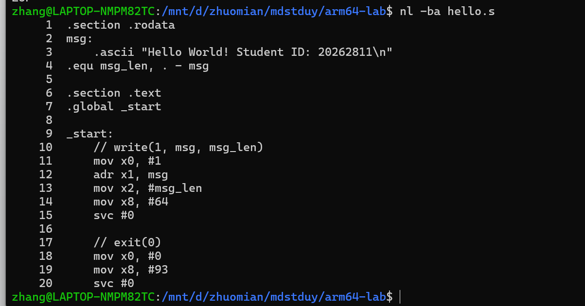

*通过write系统调用输出字符串、通过exit系统调用退出的汇编源码。*

执行汇编和链接，并检查目标文件与可执行文件的类型：

```bash
aarch64-linux-gnu-as -g -o hello.o hello.s
aarch64-linux-gnu-ld -o hello hello.o
file hello.o hello
```

`hello.o`为可重定位目标文件，`hello`为静态链接的ELF可执行文件，两者的目标架构均为ARM aarch64。

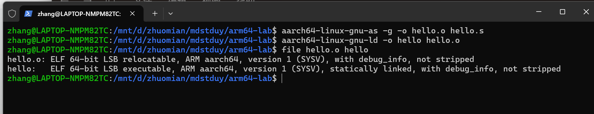

*汇编、链接成功，文件类型确认为ARM aarch64。*

使用QEMU运行：

```bash
qemu-aarch64 ./hello
echo "Exit status: $?"
```

实际输出为`Hello World! Student ID: 20262811`，退出状态为`0`。这验证了源文件、目标文件、可执行文件到模拟运行的完整流程。

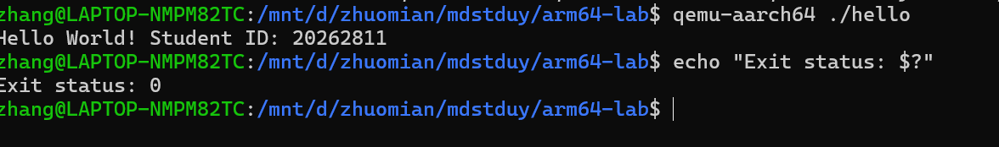

*Hello程序正确输出文字和学号，并以状态0退出。*

### 4.2 分支结构

`branch.s`使用`cmp x9, #0`比较输入值与0，通过有符号条件跳转`b.gt`选择输出。大于0时输出`positive`，否则输出`non-positive`。符号`VALUE`在汇编时通过`--defsym`指定。

完整源文件：[branch.s](src/branch.s)。

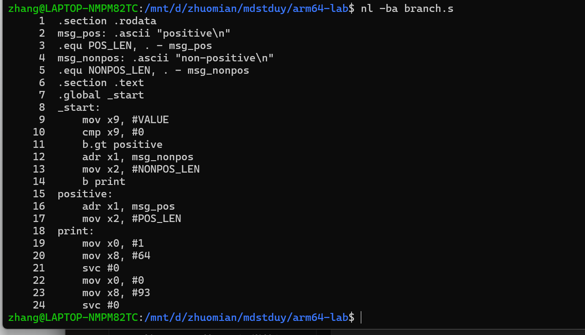

*使用cmp、b.gt和无条件跳转实现正数与非正数两个分支。*

分别构建正数、负数和零三个测试版本：

```bash
aarch64-linux-gnu-as -g --defsym VALUE=11 -o branch_pos.o branch.s
aarch64-linux-gnu-ld -o branch_pos branch_pos.o
aarch64-linux-gnu-as -g --defsym VALUE=-11 -o branch_neg.o branch.s
aarch64-linux-gnu-ld -o branch_neg branch_neg.o
aarch64-linux-gnu-as -g --defsym VALUE=0 -o branch_zero.o branch.s
aarch64-linux-gnu-ld -o branch_zero branch_zero.o

qemu-aarch64 ./branch_pos
qemu-aarch64 ./branch_neg
qemu-aarch64 ./branch_zero
```

| VALUE | 实际输出 | 判断结果 |
|---|---|---|
| 11 | positive | 进入大于0的分支 |
| -11 | non-positive | 进入非正数分支 |
| 0 | non-positive | 边界值归入非正数分支 |

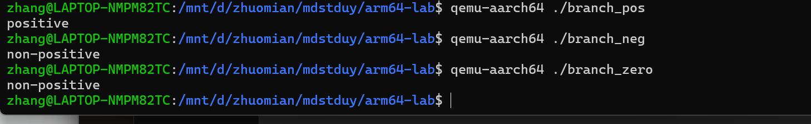

*正数、负数和零三组测试的输出均符合条件判断结果。*

### 4.3 循环结构

`loop.s`使用`x19`作为计数器，从1开始。每次将数字加48转换为ASCII字符，通过`strb`写入字符缓冲区，再调用`write`输出该数字和换行符。计数器加1后与5比较，满足小于等于条件时使用`b.le`回到循环开头。

完整源文件：[loop.s](src/loop.s)。

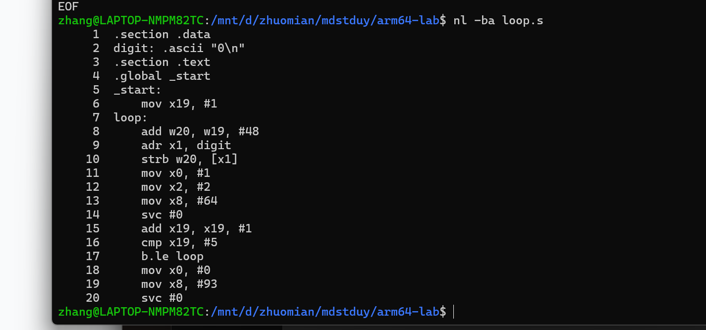

*循环程序使用计数器、条件判断、字节存储和系统调用输出数字。*

构建并运行：

```bash
aarch64-linux-gnu-as -g -o loop.o loop.s
aarch64-linux-gnu-ld -o loop loop.o
qemu-aarch64 ./loop
echo "Exit status: $?"
```

程序依次输出1、2、3、4、5，退出状态为0。循环共执行五次，计数器变为6后不再跳转。

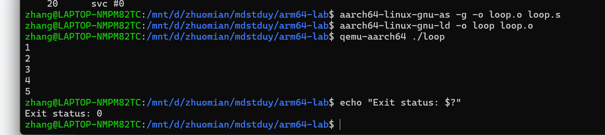

*循环完整输出1至5，随后正常退出。*

### 4.4 C调用汇编

C文件声明`extern int asm_add(int a, int b)`，调用`asm_add(8, 11)`。汇编函数通过`add w0, w0, w1`相加，再用`ret`返回。两个`int`参数通过`w0`、`w1`传入，结果通过`w0`返回。

源文件：[c_call_asm.c](src/c_call_asm.c)、[asm_add.s](src/asm_add.s)。`asm_add`没有继续调用其他函数，不需要为保存返回地址额外建立栈帧。

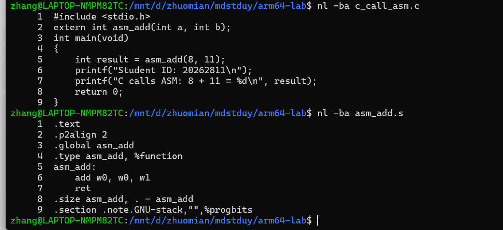

*C程序声明并调用汇编函数，汇编使用w0、w1完成整数加法。*

使用交叉GCC统一构建C和汇编文件：

```bash
aarch64-linux-gnu-gcc -g -O0 -static -o c_call_asm c_call_asm.c asm_add.s
qemu-aarch64 ./c_call_asm
echo "Exit status: $?"
```

实际输出`C calls ASM: 8 + 11 = 19`，退出状态为0，说明参数传递和汇编返回值均正确。

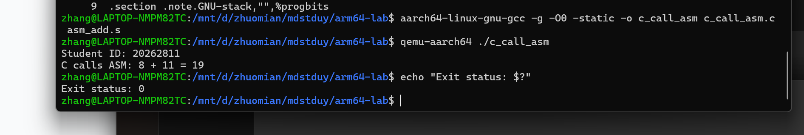

*C成功调用汇编函数，得到结果19。*

### 4.5 汇编调用C

本例由汇编实现`main`，先将8和11分别放入`w0`、`w1`，再通过`bl c_add`调用C函数。得到返回值后，将结果移入`w1`，通过`adrp`与`add`构造格式字符串地址并放入`x0`，调用`printf`输出。

由于汇编`main`会调用其他函数，它在入口使用`stp x29, x30, [sp, #-16]!`保存帧指针和返回地址，并在返回前使用`ldp`恢复。栈空间为16字节，保持调用时的对齐要求。

源文件：[c_functions.c](src/c_functions.c)、[asm_calls_c.s](src/asm_calls_c.s)。

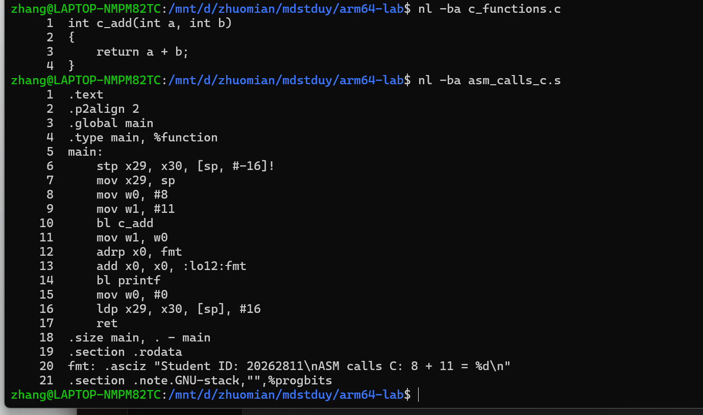

*汇编main调用C函数与printf，并保存、恢复x29和x30。*

构建并运行：

```bash
aarch64-linux-gnu-gcc -g -O0 -static -o asm_calls_c asm_calls_c.s c_functions.c
qemu-aarch64 ./asm_calls_c
echo "Exit status: $?"
```

实际输出`ASM calls C: 8 + 11 = 19`，退出状态为0。至此，两个方向的C/汇编调用均得到验证。

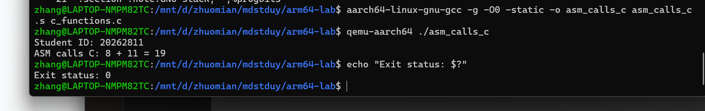

*汇编成功调用C函数，输出结果19并正常退出。*

## 四、学号程序的汇编与调用栈分析

### 5.1 C程序与预期结果

源文件命名为`week040120262811.c`。学号后两位为11，因此局部变量`i`取11。

```c
int g(int x)
{
    return x + 3;
}

int f(int x)
{
    int i = 11;
    return g(x) + i;
}

int main(void)
{
    return f(8) + 1;
}
```

计算过程为`g(8)=11`、`f(8)=11+11=22`、`main`返回`22+1=23`。程序没有输出语句，通过退出状态验证计算结果。

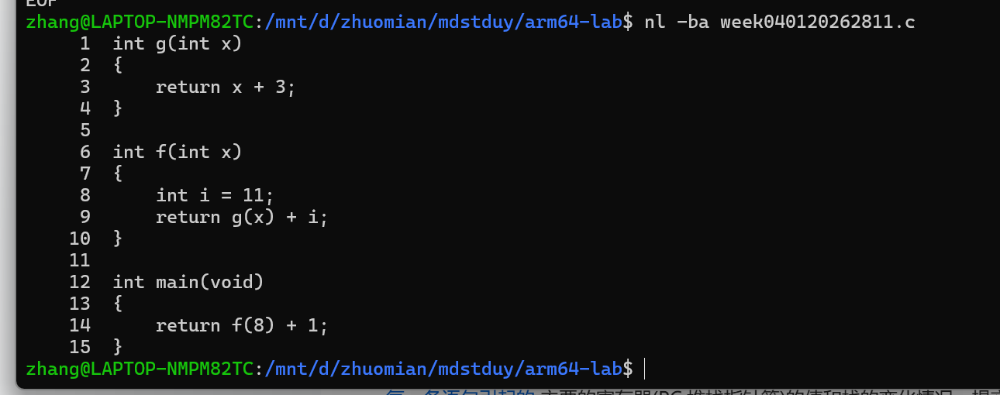

*学号C程序包含main、f、g三个函数，局部变量i为11。*

### 5.2 生成汇编与构建可执行文件

在x86_64主机上，普通本机GCC的目标架构为x86_64。为保持与前面ARM64实践一致，本次使用`aarch64-linux-gnu-gcc -S`生成ARM64汇编。

```bash
aarch64-linux-gnu-gcc -O0 -g -fno-omit-frame-pointer -S -o week040120262811.s week040120262811.c
aarch64-linux-gnu-gcc -g -static -o week0401 week040120262811.s
file week0401
qemu-aarch64 ./week0401
echo "Exit status: $?"
```

`-S`在生成汇编后停止；`-O0`关闭优化，便于观察函数调用；`-g`保留调试信息；帧指针选项使调用栈便于分析，具体是否使用`x29`仍以实际生成的函数代码为准。构建时直接使用生成的`.s`文件，使后续调试与该汇编文件对应。

实际生成ARM aarch64静态ELF程序，退出状态为23。附件保留了完整的[C源码](src/week040120262811.c)和[编译器生成的汇编文件](src/week040120262811.s)。

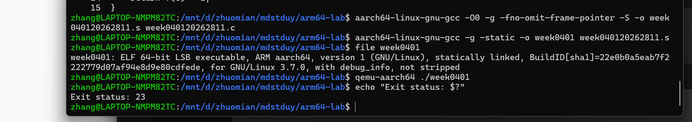

*交叉GCC生成汇编并构建程序，QEMU运行后的退出状态为23。*

### 5.3 观察实际生成的函数代码

进入GDB查看`f`的实际机器指令：

```bash
gdb-multiarch -q ./week0401
```

```gdb
set pagination off
disassemble f
```

`f`共包含12条指令，入口分配48字节栈空间，保存旧`x29`、`x30`，然后保存参数、初始化局部变量、调用`g`，最后恢复栈帧并返回。

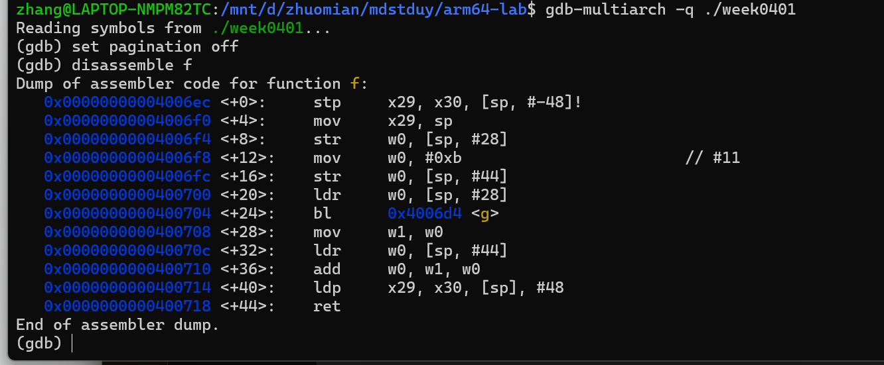

*f的反汇编包含参数保存、局部变量赋值、函数调用、返回值计算和栈帧恢复。*

从生成的`.s`文件摘取`g`和`main`的指令，省略调试信息与展开指示：

```asm
g:
    sub sp, sp, #16
    str w0, [sp, #12]
    ldr w0, [sp, #12]
    add w0, w0, #3
    add sp, sp, #16
    ret

main:
    stp x29, x30, [sp, #-16]!
    mov x29, sp
    mov w0, #8
    bl f
    add w0, w0, #1
    ldp x29, x30, [sp], #16
    ret
```

本次生成的`g`是叶函数，只调整SP，没有重新建立`x29`帧指针；`main`和`f`需要继续调用其他函数，因此保存并恢复返回地址。这也说明，分析调用栈应结合SP、指令和调试信息，不能假设每个函数都一定更新`x29`。

### 5.4 连接QEMU并记录f的入口状态

在另一个Ubuntu终端进入原实验目录，启动等待调试连接的程序：

```bash
qemu-aarch64 -g 1234 ./week0401
```

在GDB终端设置日志、连接目标并在第一条指令处断下：

```gdb
set logging file gdb-stack.log
set logging overwrite on
set logging enabled on
target remote localhost:1234
break *f
continue
set $entry_sp = $sp
set $entry_fp = $x29
set $entry_lr = $x30
x/i $pc
info registers pc sp x29 x30 x0
x/6gx $sp
```

`break *f`停在函数首条机器指令执行之前。此时`PC=0x4006ec`，`SP=x29=0x55007ff7e0`，`x30=0x40072c`，参数寄存器`x0=8`。由于函数序言尚未执行，GDB按源码位置显示的`f(x=0)`暂不能反映刚进入函数时的实际传参，应结合寄存器及后续入栈结果判断。

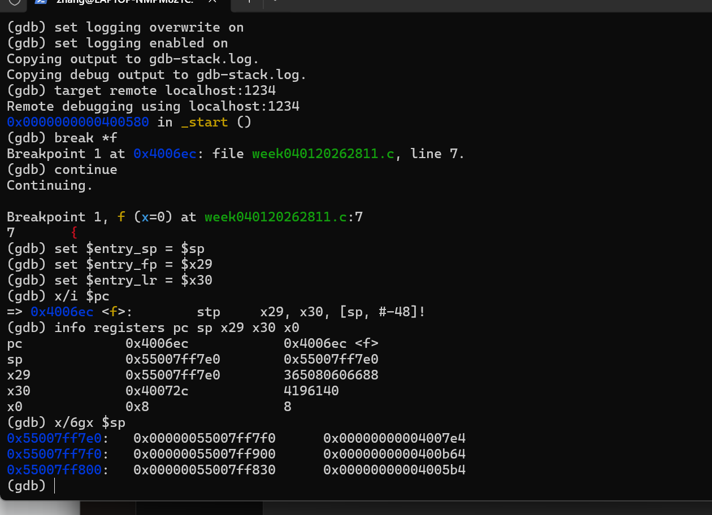

*f入口处尚未执行stp，参数8位于x0，返回main的地址位于x30。*

### 5.5 栈帧形成与局部变量赋值

使用`si`一次执行一条机器指令。执行`stp x29, x30, [sp, #-48]!`后，SP从`0x55007ff7e0`减为`0x55007ff7b0`，在新栈顶保存旧帧指针和返回地址；执行`mov x29, sp`后，当前帧指针也变为`0x55007ff7b0`。

主要观察命令为：

```gdb
si
info registers pc sp x29 x30
x/2gx $sp
```

栈顶两个8字节保存槽分别为`0x55007ff7e0`和`0x40072c`。

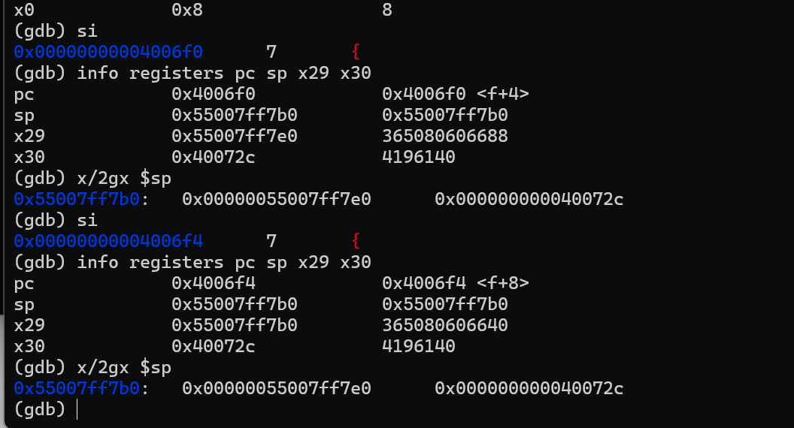

*stp分配48字节并保存旧寄存器，mov随后建立f的帧指针。*

执行`str w0, [sp, #28]`后，参数8被保存到`0x55007ff7cc`。使用`x/wd $sp+28`以4字节整数、十进制格式读取该位置，得到8。

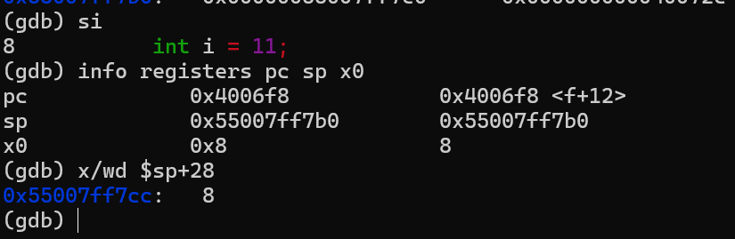

*参数x=8被保存到f栈帧的SP+28位置。*

执行`mov w0, #11`后，`x0`显示为`0xb`，即十进制11。此时只是把常数放入寄存器，下一条存储指令才会把它写入局部变量的栈槽。

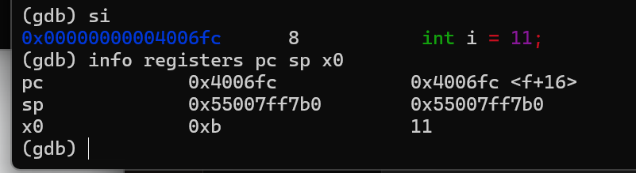

*寄存器w0准备好局部变量i的初始值11。*

执行`str w0, [sp, #44]`后，局部变量`i`保存到`0x55007ff7dc`。再次读取参数槽和局部变量槽，分别得到8和11。

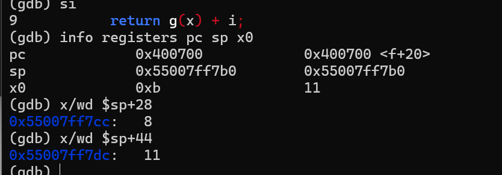

*栈中的参数x为8，局部变量i为11，二者分别占4字节。*

### 5.6 调用g与返回f

`ldr w0, [sp, #28]`先把参数8从栈中取回`w0`。随后执行`bl g`，PC跳到`0x4006d4`，`x30`更新为返回`f`的地址`0x400708`，SP此时仍为`0x55007ff7b0`。

此时栈中保存的`0x40072c`仍是`f`返回`main`的地址，它与寄存器`x30`中返回`f`的地址有不同用途。

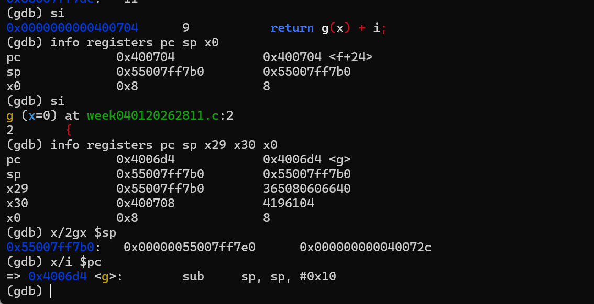

*bl将新的返回地址写入x30；f栈中保存的上一层返回地址保持不变。*

进入`g`后，执行首条`sub sp, sp, #16`，SP变为`0x55007ff7a0`，`x29`仍指向`f`的帧。使用`finish`运行完当前的`g`函数，停回`f`的`0x400708`。

```gdb
si
info registers pc sp x29 x30 x0
finish
info registers pc sp x29 x30 x0
x/i $pc
x/wd $sp+44
```

GDB显示返回值为11，SP恢复为`0x55007ff7b0`，局部变量`i`仍为11。本次对`f`的指令逐条记录；对`g`则观察分配栈空间和返回两个关键状态，其余内部指令通过`finish`执行完成。

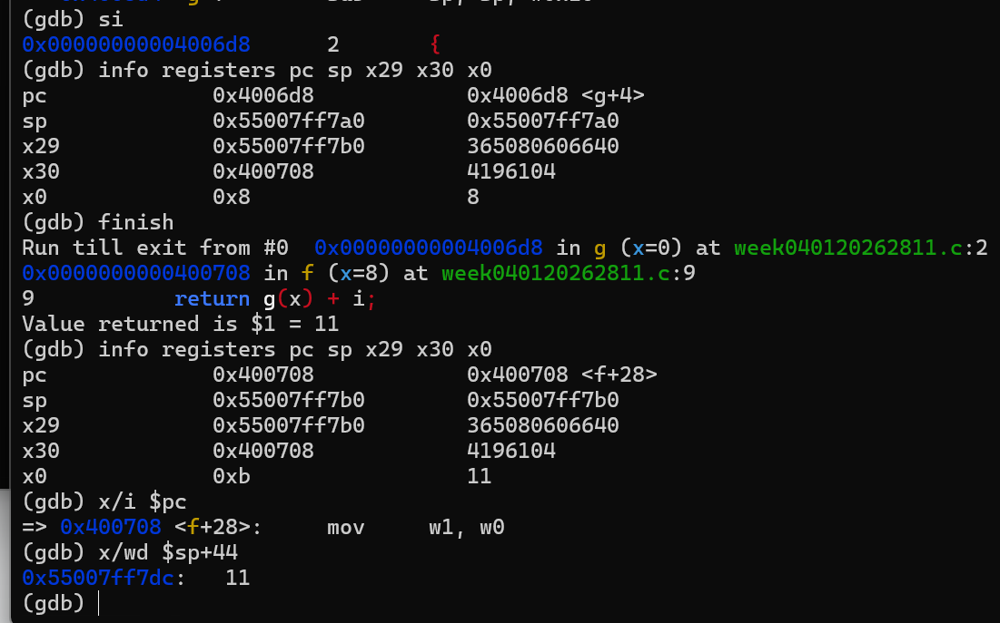

*g临时分配16字节栈空间，返回时恢复SP，并通过w0返回11。*

### 5.7 计算f的返回值

返回`f`后，`mov w1, w0`保存`g(x)`的结果，`ldr w0, [sp, #44]`读取局部变量`i`，最后`add w0, w1, w0`计算二者之和。

本次`g(8)`和`i`恰好都等于11，但两个寄存器保存的数据来源不同。加法执行后`x0=0x16`，即十进制22，PC停在`0x400714`，即恢复栈帧的指令处。

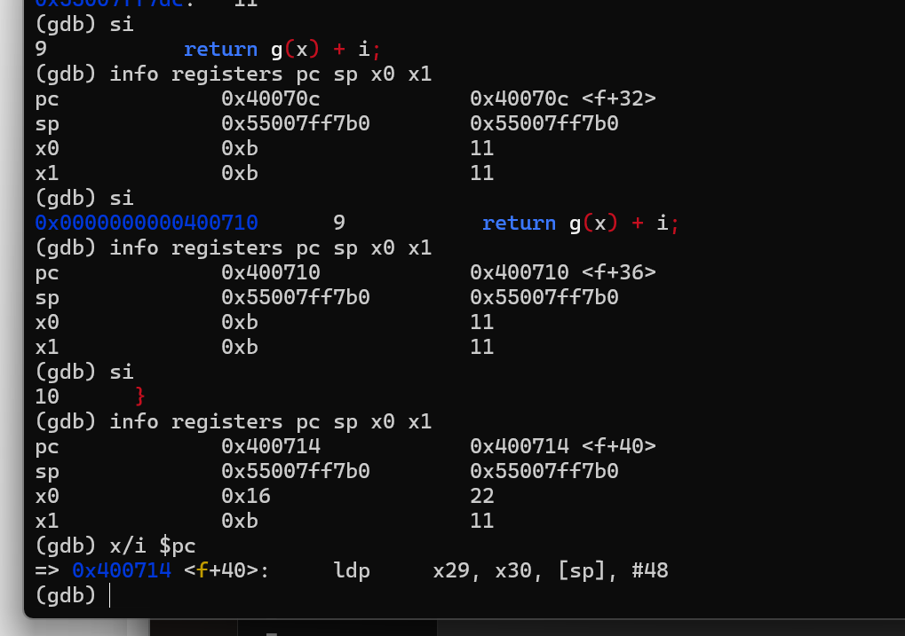

*分别保存g的返回值和局部变量i，完成11+11=22的计算。*

### 5.8 恢复栈帧、返回main并退出

执行`ldp x29, x30, [sp], #48`，从栈中恢复旧帧指针和返回地址，并将SP增加48字节。此时`SP=x29=0x55007ff7e0`，`x30=0x40072c`，返回值`x0`仍为22。

继续执行`ret`，PC跳到`main`中的`0x40072c`；再执行`main`的加1指令，`x0`变为`0x17`，即十进制23。栈帧释放通过恢复SP完成，不要求原有内存字节立即清零。

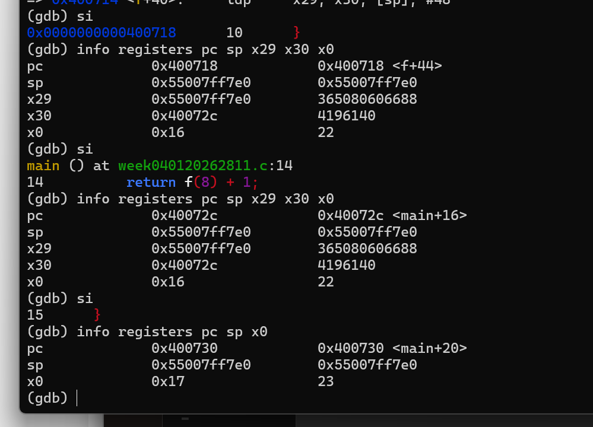

*f恢复SP、x29和x30后返回main，main随后将结果加1得到23。*

继续运行至程序结束，关闭日志并退出GDB：

```gdb
continue
set logging enabled off
quit
```

GDB显示`exited with code 027`。这里`027`是八进制表示，`2×8+7=23`，与前面在shell中观察到的十进制退出状态23一致。

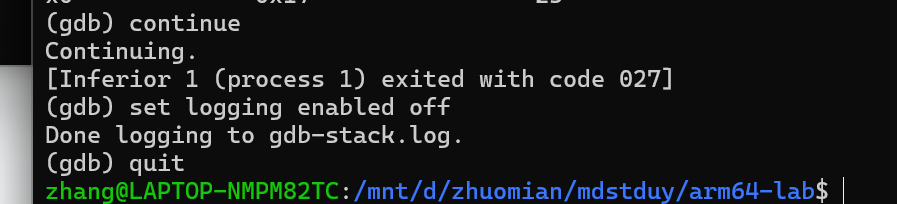

*程序以八进制退出码027结束，日志保存后正常退出GDB。*

### 5.9 栈帧布局与逐条指令变化汇总

为简化记录，定义：

| 记号 | 完整地址 | 含义 |
|---|---|---|
| S0 | `0x55007ff7e0` | 进入f前、返回main后的SP |
| S1 | `0x55007ff7b0` | f分配48字节后的SP |
| Sg | `0x55007ff7a0` | g再分配16字节后的SP |

SP的关键变化为`S0 → S1 → Sg → S1 → S0`。下列栈布局对应`f`已完成参数保存和`i`赋值、尚未释放栈帧的阶段：

| f栈帧偏移 | 内存起始地址 | 大小 | 内容 |
|---|---|---|---|
| SP+44 | `0x55007ff7dc` | 4字节 | 局部变量i=11 |
| SP+32～SP+43 | `0x55007ff7d0` | 12字节 | 本例未使用的区域 |
| SP+28 | `0x55007ff7cc` | 4字节 | 保存的参数x=8 |
| SP+16～SP+27 | `0x55007ff7c0` | 12字节 | 本例未使用的区域 |
| SP+8 | `0x55007ff7b8` | 8字节 | 保存的x30=`0x40072c` |
| SP+0 | `0x55007ff7b0` | 8字节 | 保存的旧x29=`0x55007ff7e0` |

以上合计48字节。地址从高到低排列，栈分配方向为低地址方向。保存槽中的旧`x29`指向调用者的帧，当前`x29`则指向本函数的帧。

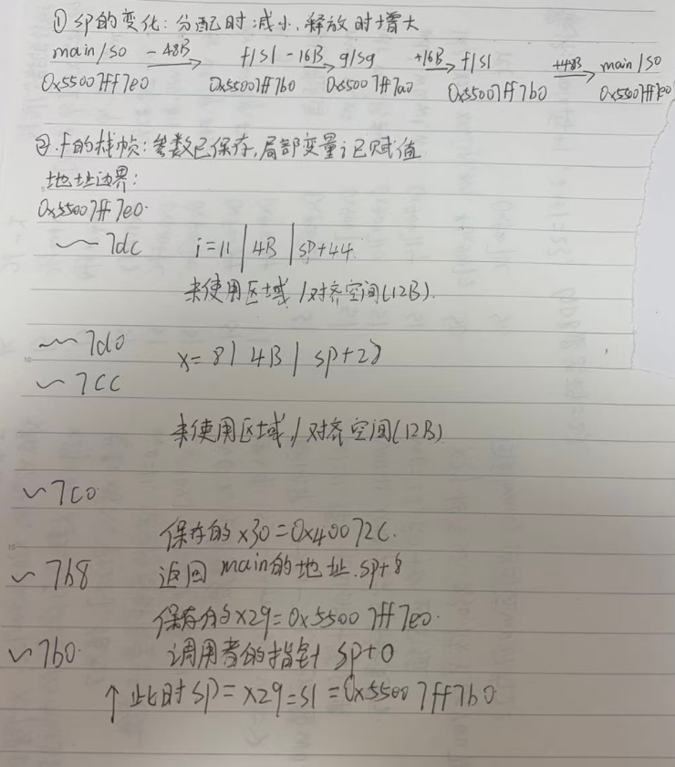

*手绘记录SP的分配、恢复路径，以及f栈帧中参数、局部变量和寄存器保存槽的位置。*

下表记录每条`f`指令执行后的关键状态，未列出的项目沿用前一状态；另外列出`g`完成并返回的观察点。

| 执行的指令或阶段 | 执行后PC | SP | 关键变化 |
|---|---|---|---|
| `stp x29,x30,[sp,#-48]!` | `0x4006f0` | S1 | 保存旧x29=S0、x30=0x40072c；x29暂仍为S0 |
| `mov x29,sp` | `0x4006f4` | S1 | x29=S1 |
| `str w0,[sp,#28]` | `0x4006f8` | S1 | 参数槽写入8 |
| `mov w0,#11` | `0x4006fc` | S1 | w0=11 |
| `str w0,[sp,#44]` | `0x400700` | S1 | 局部变量i=11 |
| `ldr w0,[sp,#28]` | `0x400704` | S1 | w0=8，准备传给g |
| `bl g` | `0x4006d4` | S1 | 进入g，x30=0x400708 |
| g执行并返回 | `0x400708` | S1 | SP曾为Sg，返回后恢复S1；w0=11 |
| `mov w1,w0` | `0x40070c` | S1 | w1=11，保存g的结果 |
| `ldr w0,[sp,#44]` | `0x400710` | S1 | w0=11，读取i |
| `add w0,w1,w0` | `0x400714` | S1 | w0=22 |
| `ldp x29,x30,[sp],#48` | `0x400718` | S0 | x29=S0，x30=0x40072c |
| `ret` | `0x40072c` | S0 | 返回main，w0仍为22 |

`main`随后执行`add w0, w0, #1`，PC到达`0x400730`，返回值变为23。表中的绝对地址来自本次实际调试；其他编译配置或运行环境中的地址可能不同，应以实际指令和相对偏移分析。

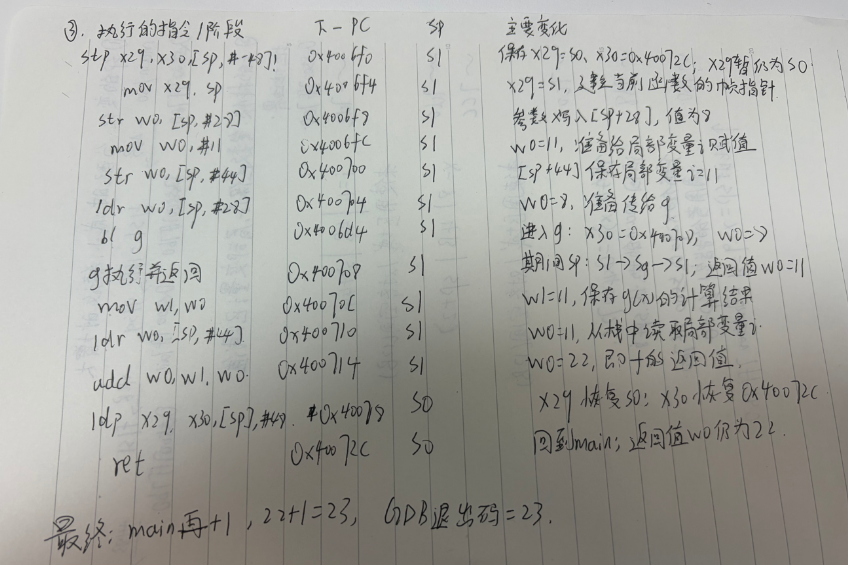

*手绘记录每条指令执行后的PC、SP，以及参数、局部变量和返回地址的变化。*

## 六、实验中遇到的问题与处理

### 6.1 主机架构与目标架构的区别

`uname -m`显示x86_64，说明WSL中运行的Linux主机环境是x86_64。本次通过`aarch64-linux-gnu-`前缀的交叉工具生成ARM64文件，并用`file`确认目标架构，再交由`qemu-aarch64`执行。

### 6.2 GDB多行粘贴引起表达式语法错误

调试过程中，批量粘贴的多条命令被当前终端/GDB当成一条命令解析，导致`A syntax error in expression`。处理时先读取PC，确认仍停在`0x4006ec`，再改为每次单独执行一行，避免把错误粘贴误认为成功单步。原始日志保留了这一过程。

### 6.3 函数入口的源码参数显示与寄存器值不同

在函数首条指令处，栈帧和参数保存槽尚未建立，GDB曾显示`f(x=0)`、`g(x=0)`。实际参数寄存器为8，后续参数写入栈后也验证为8。因此应结合机器指令执行阶段判断调试信息，不能仅凭入口处的源码级参数显示认定传参错误。

### 6.4 十六进制、十进制和八进制的转换

寄存器中的`0xb`、`0x16`、`0x17`分别为十进制11、22、23。`x/wd`便于按十进制读取4字节整数，GDB的程序退出显示`027`则为八进制，需要与shell中的十进制23对照。

## 七、实验结论

本次完成了ARM64汇编的汇编、链接与QEMU模拟运行，分支测试覆盖正数、负数和零，循环程序正确输出1至5，C与汇编两个方向的调用都得到结果19。

在学号程序中，逐条跟踪了`f`的12条机器指令，并观察了`g`的栈空间分配与返回。实际记录验证了：参数通过寄存器传递后可保存到栈中；局部变量具有具体栈偏移；`bl`更新链接寄存器，非叶函数通过保存槽保留上一层返回地址；函数返回前恢复寄存器和SP，调用者从返回值寄存器取得计算结果。最终`g(8)=11`、`f(8)=22`、`main`返回23，与预期一致。
