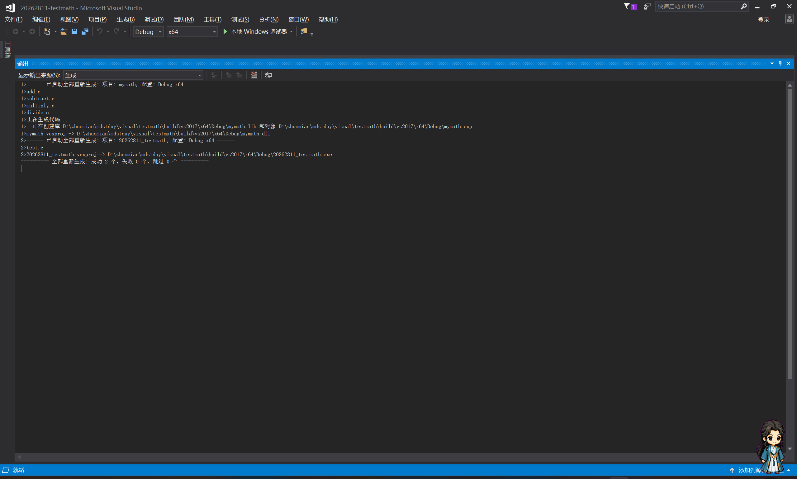
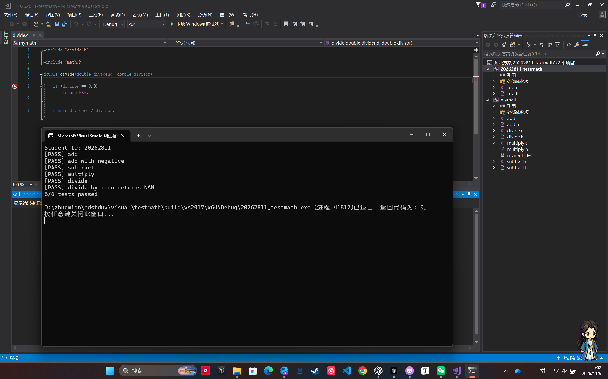
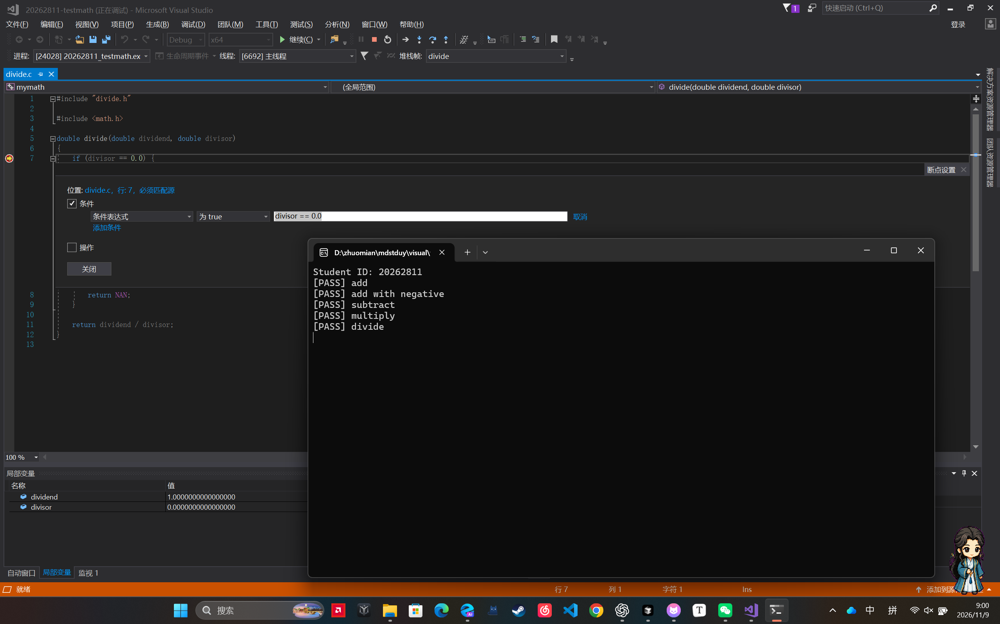

# 20262811《Linux内核原理与分析》四则运算DLL实验

实验使用Visual Studio 2017，配置为`Debug | x64`。`test.c`包含`main()`，调用`mymath.dll`导出的加、减、乘、除四个函数，并运行六项测试。

## 编译和运行调用端

打开VS2017的`x64 Native Tools Command Prompt`，切换到本目录后运行以下命令。`mymath.lib`供链接器使用，Windows运行程序时从EXE所在目录加载`mymath.dll`。

```bat
cl /nologo /W4 /Fe:20262811_testmath.exe test.c mymath.lib
.\20262811_testmath.exe
```

## 实验截图

### 1. 生成DLL成功

VS2017生成了`mymath.dll`和`mymath.lib`，解决方案的两个项目均生成成功。



### 2. 调用DLL并通过测试

控制台显示学号`20262811`和`6/6 tests passed`，程序正常退出，返回码为`0`。



### 3. 命中条件断点

在`divide.c`第7行设置条件`divisor == 0.0`。正常除法通过后，程序在除数为零的调用中暂停。画面同时显示黄色执行箭头、断点条件和局部变量`divisor = 0`。


