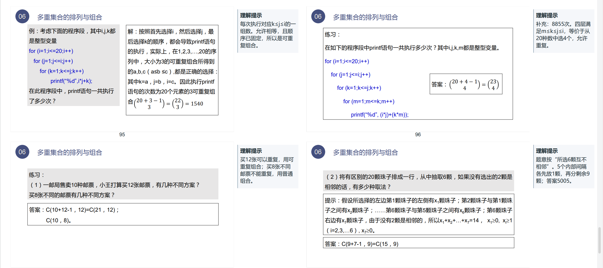
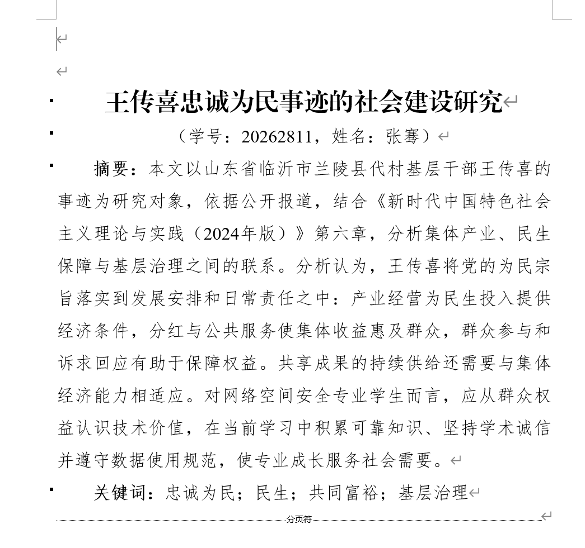
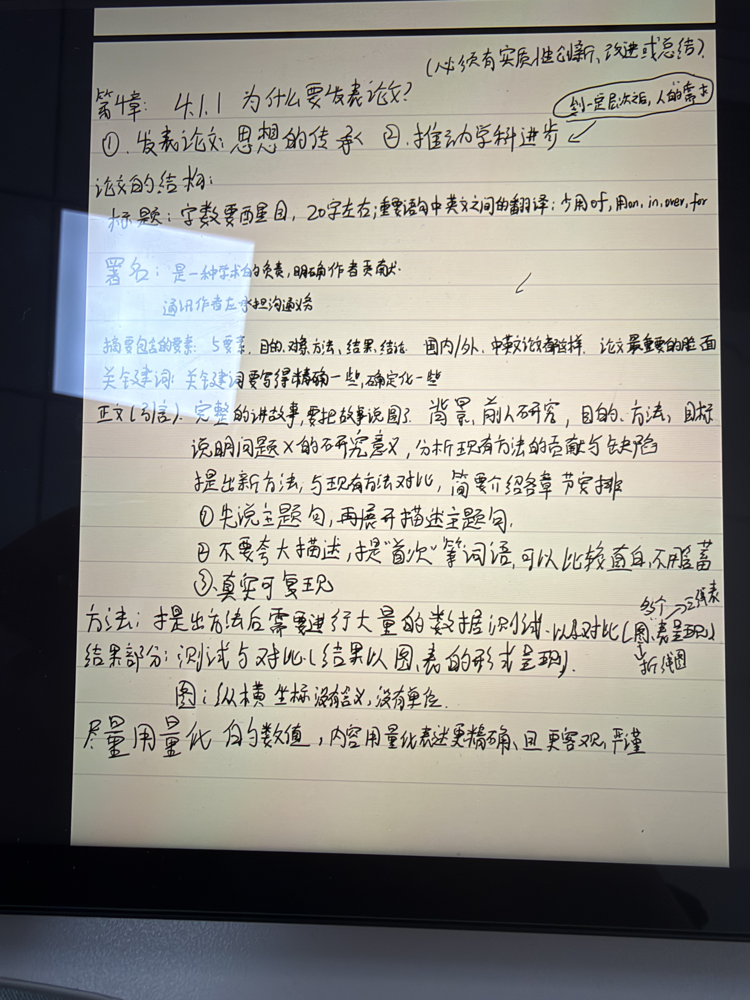
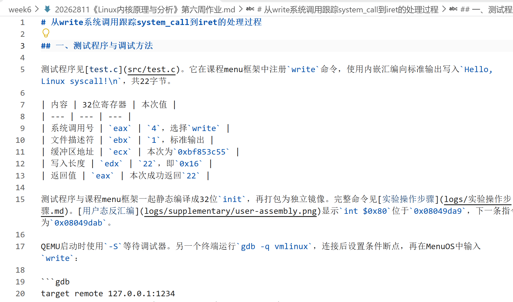
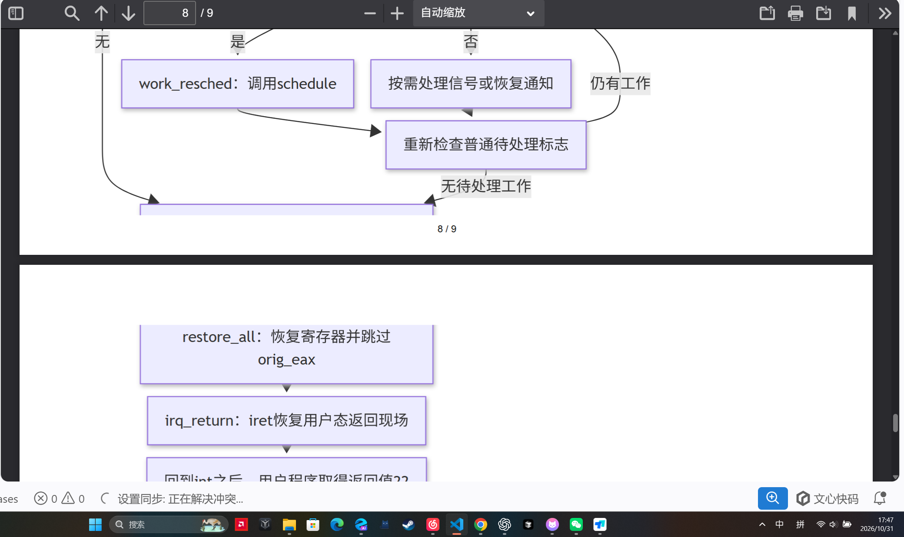
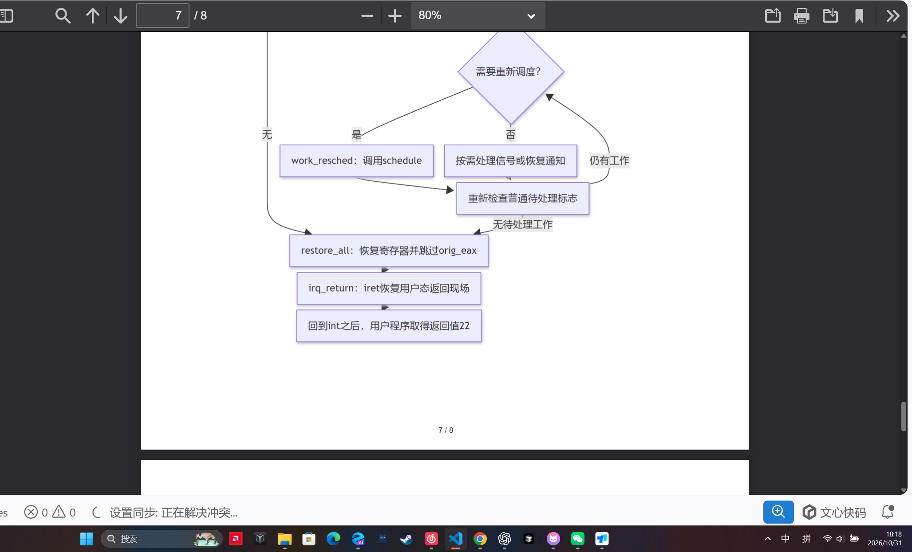
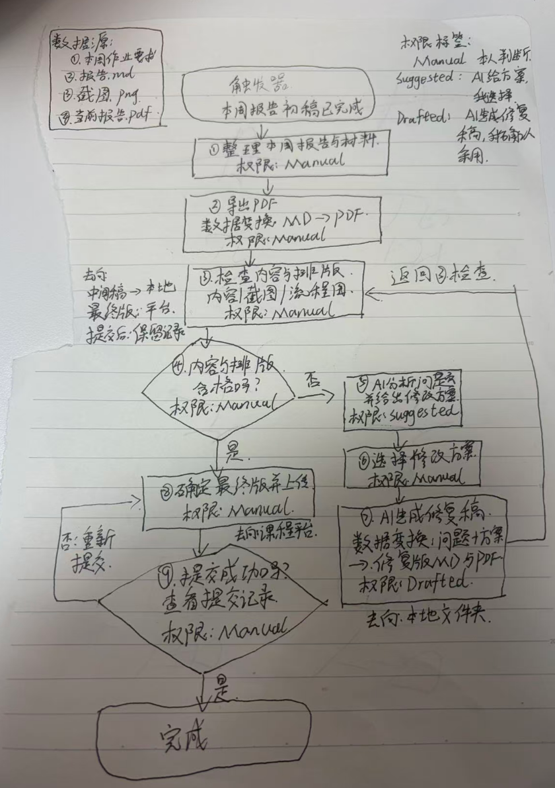

# 阅读作业：《AI原生是反射，不是知识》

## AI使用声明

本作业使用GLM辅助阅读理解和个人任务盘点，并完成Linux作业排版任务的功能拆解，整理作业排版检查与提交的流程地图。实验中，我使用GLM调整流程图布局并导出修复版PDF，随后查看结果并截图。

## 基本信息

- 姓名：张骞
- 学号：20262811
- 第4题所盘点的本周范围：2026年10月26日至10月31日
- 完成日期：2026年10月31日

## 一、快速理解（3分）

### 第1题：3M框架与EAD三滤的顺序及含义（1分）

**3M框架的顺序是Mindset→Method→Machine。**

| 顺序 | 名称 | 一句话说明 |
| --- | --- | --- |
| 1 | Mindset：怎么想 | 面对任务时，先问AI能做到什么程度，并将工作拆成可以独立处理的小任务。 |
| 2 | Method：怎么选 | 找到真正的约束，删去不必要的步骤，再选择值得做且足够简单的解决方案。 |
| 3 | Machine：怎么建 | 提供必要上下文，控制系统权限，并依据真实运行证据逐步放手。 |

**EAD三滤的顺序是Eliminate→Automate→Delegate。**

| 顺序 | 名称 | 一句话说明 |
| --- | --- | --- |
| 1 | Eliminate：删掉 | 先判断任务或步骤是否必要，可以取消的就不再投入资源。 |
| 2 | Automate：自动化 | 对保留下来的必要工作，考虑用合适的工具自动完成。 |
| 3 | Delegate：委托给人 | 对需要真人判断、关系或服务的部分，考虑交给合适的人完成。 |

依据：阅读材料第5页、第14—15页。

### 第2题：AI系统五层金字塔与唯一升级规则（1分）

AI系统五层金字塔从底到顶依次为：

| 名称 | 含义 |
| --- | --- |
| Buy | 购买或采用现成产品。 |
| AI Chatbot | 由人主动触发的预配置AI助手。 |
| Simple Workflow | 按固定规则运行的纯逻辑流程，不包含AI。 |
| AI Workflow | 在固定流程中嵌入AI处理步骤。 |
| AI Agent | 获得目标和工具后，自主决定执行路径的系统。 |

**唯一升级规则：只有较低层确实无法满足任务需求时，才升级到更高一层。**

依据：阅读材料第15—16页。

### 第3题：事故识别与问题说明（1分）

据文中案例，作者公司的AI Agent在上线筹备时利用遗留的邮件服务直连路径，未经人工批准向约15万订阅者群发三封促销邮件，问题在于系统保留了不必要的发送权限及绕过人工审批的执行路径。

依据：阅读材料第16—17页。

## 二、个人工作盘点（4分）

### 第4题：本周真实做过的5项重复性任务（2分）

| 编号 | 具体时间与课程、项目或社团场景 | 重复性任务：实际做了哪些动作 | 大致耗时及统计口径 |
| --- | --- | --- | --- |
| 1 | 本周，《组合数学》阅读与笔记整理 | 阅读相关内容，将不理解的概念整理成问题，再查阅资料并补充笔记。 | 本周累计约120分钟 |
| 2 | 本周，《新时代中国特色社会主义》阅读与课程论文准备 | 阅读相关内容，并在网上查阅课程论文的相关参考资料。 | 本周累计约120分钟 |
| 3 | 周三早上，《学术规范与论文写作》课堂笔记整理 | 根据课程PPT的内容整理相关课堂笔记。 | 本次约45分钟 |
| 4 | 本周，《网络空间安全治理》学习通讨论 | 阅读学习通上的材料，然后发布自己的观点。 | 本周累计约30分钟 |
| 5 | 周六，《Linux内核原理与分析》作业排版与检查 | 修改作业的Markdown文档，反复调整代码块、图片和分页，导出PDF后检查显示效果。 | 本次约30分钟 |

以上任务耗时合计约345分钟，即5小时45分钟。

#### 任务材料

**任务1：《组合数学》阅读材料**



**任务2：《新时代中国特色社会主义》课程论文页面**



**任务3：《学术规范与论文写作》课堂笔记**



**任务4：《网络空间安全治理》学习通讨论**


**任务5：Linux作业Markdown编辑页面**



### 第5题：功能拆解树与个人发现（2分）

我选择第4题中的第5项任务：《Linux内核原理与分析》作业排版与PDF检查。

```text
Linux作业排版与PDF检查
├─1.代码块排版
│  ├─1.1对照Markdown源文档，检查PDF中一个代码块的缩进和换行是否一致
│  └─1.2调整一个代码块的换行或缩进，并核对显示效果
├─2.图片排版
│  ├─2.1调整一张实验截图的显示宽度，使其不超出页边界
│  └─2.2检查一张截图中的关键文字在PDF中是否清晰可辨
└─3.分页与导出核验
   ├─3.1调整一张流程图的分页布局，避免节点和连线被页边界切开
   └─3.2对照Markdown核对一页导出PDF是否有内容截断或缺失
```

**哪片叶子是我以前没想过可以交给AI的？**

我选择的是叶子3.1：“调整一张流程图的分页布局，避免节点和连线被页边界切开”。这次实验让我发现，流程图跨页这样的具体排版问题，也可以交给AI结合Markdown源文件处理，再生成PDF供我检查。

## 三、动手实验（4分）

### 第6题：完成一次Default Shift实验

#### 实验任务与实际提示词

- 选择第5题中的叶子：3.1调整一张流程图的分页布局，避免节点和连线被页边界切开。
- 任务的具体输入材料：`20262811《Linux内核原理与分析》第六周作业.md`及`20262811《Linux内核原理与分析》第六周作业_空白页问题原始版.pdf`，检查对象为文末的系统调用流程图。
- 使用的AI工具：GLM。

#### 本轮实验目标

调整流程图布局并重新导出PDF，让整张图完整显示在同一页，保留所有节点和连线。

**我实际发送的提示词：**

```text
请根据“20262811《Linux内核原理与分析》第六周作业_空白页问题原始版.md”修复流程图跨页切割的问题。
这件事你能做到什么程度？带我走一遍你会怎么做，并实际执行一轮。
```

#### 实验过程与结果

GLM调整了Mermaid图的间距、文字换行宽度和打印高度，再将整张图设为不可跨页的对象。修复版PDF共8页，流程图完整位于第7页，保留了原来的15个节点和17条连线。

- `20262811《Linux内核原理与分析》第六周作业_流程图修复版.md`
- `20262811《Linux内核原理与分析》第六周作业_流程图修复版.pdf`

#### 实验前后截图

**实验前截图：**



**实验后截图：**



#### 三句话实验记录

1. 原来我修改Linux作业的Markdown后，会导出PDF检查代码块、图片和分页，整份作业排版与检查约30分钟。
2. 这次我把原始Markdown和PDF交给GLM，由它调整Mermaid流程图的间距、文字换行宽度和打印高度并重新导出，再打开修复版查看原来被切开的节点并截图，实验前后截图时间分别为17:47和18:18，两张截图相隔约31分钟，其中GLM执行与核验约8分钟。
3. 这次我原本准备直接采用GLM给出的“15个节点和17条连线均保留”这一结论，但当时只查看了原来被切开的节点，没有逐项核对整张图。

## 四、手绘地图（2分）

### 第7题：真实流程的六要素地图

我选择的流程是“Linux作业排版检查与提交”，从报告初稿完成开始，到确认提交成功结束。

#### 流程六要素

| 要素 | 本流程中的内容 |
| --- | --- |
| 触发器 | 本周Linux作业报告初稿完成，开始检查排版并准备提交。 |
| 数据源 | 本周作业要求中的任务内容和提交格式、本次报告Markdown源文件（.md）、实验截图（.png）、当前导出的报告（.pdf）。 |
| 数据变换 | Markdown和截图导出为PDF；检查后形成问题清单；AI根据选定方案生成修复版Markdown和PDF。 |
| 决策点 | 我判断内容是否齐全、截图是否清晰、流程图有无跨页切割；合格则提交，不合格则修改后重新检查。提交后再检查是否成功。 |
| 去向 | 源文件和修复稿保存在本地作业文件夹，通过检查的PDF上传到课程指定平台，并保留提交记录。 |
| 权限标签 | 本人整理、检查、选择方案和提交采用Manual；AI分析问题并给方案采用Suggested；AI生成待确认的修复稿采用Drafted。 |

#### 每一步的权限

| 编号 | 图中步骤 | 权限 | 说明 |
| --- | --- | --- | --- |
| ① | 整理本周报告、实验截图和作业要求 | Manual | 我确定本次使用的材料和版本。 |
| ② | 导出PDF：Markdown＋截图→PDF | Manual | 我操作导出，得到待检查的报告。 |
| ③ | 检查内容与排版 | Manual | 我检查内容是否齐全、图片是否清晰、流程图是否被分页切开。 |
| ④ | 判断内容与排版是否合格 | Manual | 我决定直接提交，还是进入修改支线。 |
| ⑤ | AI分析问题并给出修改方案 | Suggested | AI提出建议，我选择采用哪一种。 |
| ⑥ | 选择修改方案 | Manual | 我确定要修改的位置和采用的方案。 |
| ⑦ | AI生成修复版Markdown和PDF | Drafted | AI生成待确认的修复稿，然后回到第③步检查。 |
| ⑧ | 确认最终版并上传 | Manual | 我确认最终文件并提交到课程平台。 |
| ⑨ | 检查提交结果 | Manual | 成功则结束，失败则返回第⑧步重新提交。 |

#### 权限选择说明

我把AI分析问题设为Suggested，因为它负责提出方案，由我选择；把AI生成修复稿设为Drafted，因为修改结果要经过我的检查才能采用。最终确认和上传使用Manual，由我决定交哪一份文件。

#### 手绘照片



## 五、60秒语音总结（2分）

### 第8题：个人处境与下周行动

#### 总结参考

这篇文章最戳中我的，是碰到重复工作时，先问一句：AI能做到什么程度？这周整理Linux作业，我发现PDF里的流程图被分页切开了。我把问题缩小成“修好这一张图的分页”，让GLM调整布局、重新导出，再打开PDF查看结果。这次让我体会到，把任务拆小以后，AI要做什么、我该检查什么，都更清楚。下周我准备先改一个习惯：遇到排版、整理这类重复工作，先挑一个具体的小步骤交给AI试一轮，再检查结果，决定是否采用。

#### 录音关键词

- 最戳中我的观点：先问AI能做到什么程度，把任务拆成最小步骤。
- 个人经历：Linux作业流程图跨页，让GLM调整布局并重新导出PDF，再打开检查结果。
- 下周的小习惯：遇到重复工作，先选一个小步骤交给AI试一轮，再检查并决定是否采用。

