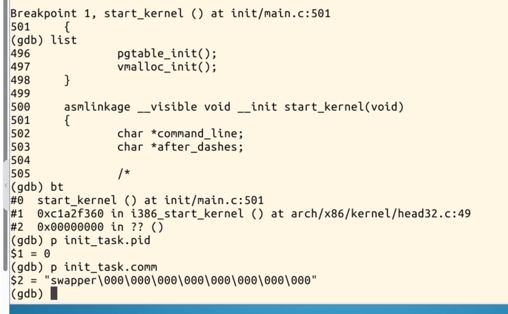
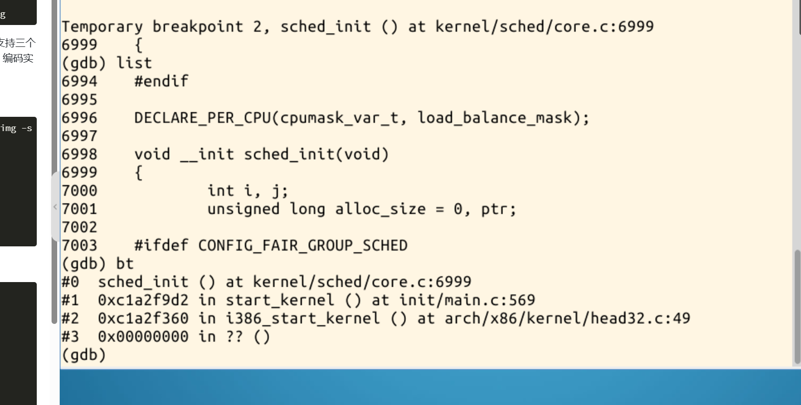
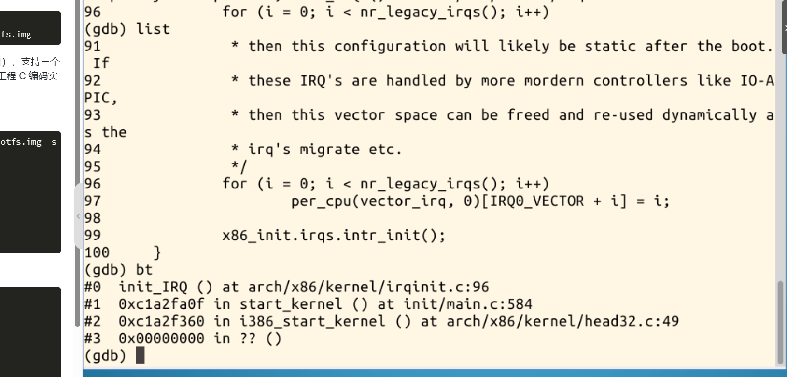
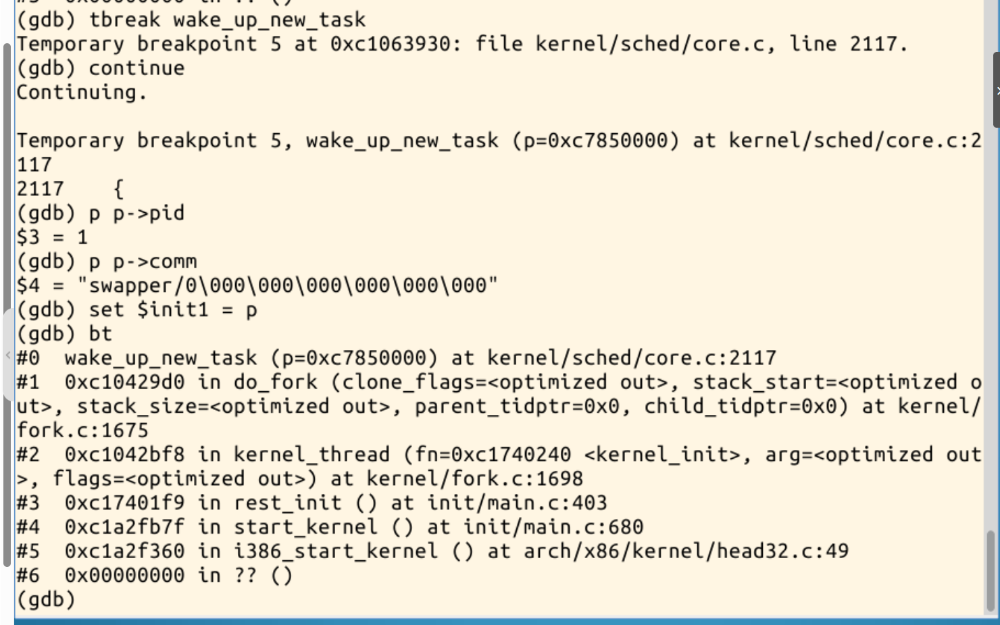
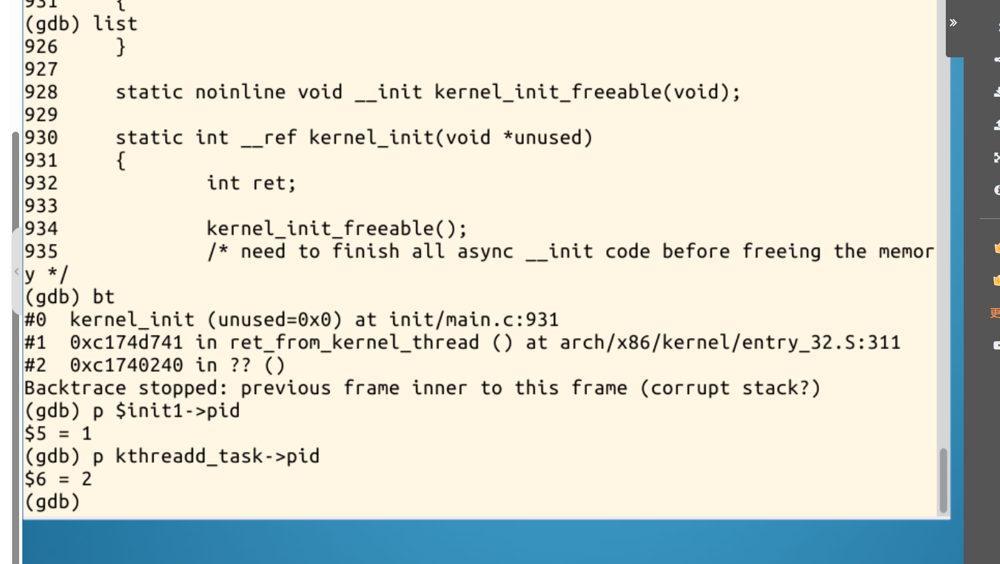
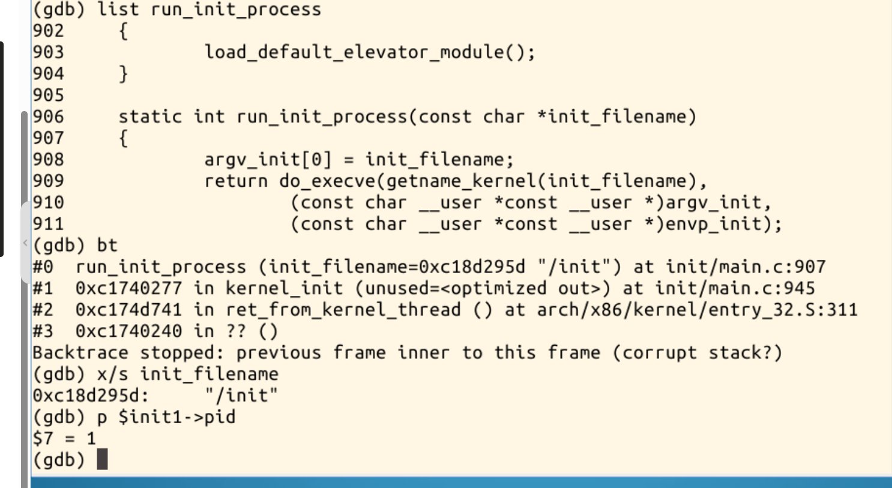
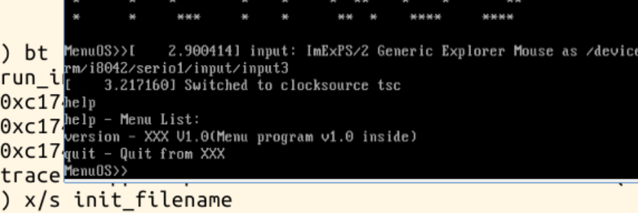

# 跟踪分析Linux内核的启动过程

## 一、实验目的与准备

本实验从`start_kernel()`开始设置断点，观察调度器、中断初始化以及初始进程的创建，继续跟踪到内核准备执行`/init`，最后验证MenuOS能够运行。重点回答三个问题：内核如何建立运行环境，0号idle任务从哪里来，1号进程如何进入用户空间。

在实验楼虚拟机的终端中检查实验文件与工具：

```bash
cd ~/LinuxKernel
ls -lh linux-3.18.6/vmlinux \
       linux-3.18.6/arch/x86/boot/bzImage \
       linux-3.18.6/init/main.c \
       rootfs.img
command -v qemu
command -v gdb
```

其中，`bzImage`用于启动内核，`vmlinux`提供GDB所需的符号和调试信息，二者需要对应同一次内核构建；`rootfs.img`提供实验使用的初始根文件系统。

先正常启动，确认能够进入MenuOS：

```bash
qemu -kernel linux-3.18.6/arch/x86/boot/bzImage -initrd rootfs.img
```

完成正常启动检查后关闭该QEMU实例，再用调试参数启动：

```bash
qemu -kernel linux-3.18.6/arch/x86/boot/bzImage -initrd rootfs.img -s -S
```

`-s`开启TCP 1234端口的GDB调试接口，`-S`让虚拟CPU在启动时暂停。因此，此时QEMU显示黑屏和`Stopped`是预期现象，需要通过GDB的`continue`命令继续运行。[QEMU GDB调试说明](https://www.qemu.org/docs/master/system/gdb.html)

另开一个终端，执行：

```bash
cd ~/LinuxKernel
gdb linux-3.18.6/vmlinux
```

以下命令在GDB的`(gdb)`提示符中输入：

```gdb
set pagination off
target remote localhost:1234
break start_kernel
continue
```

## 二、进入start_kernel，观察初始任务

命中`start_kernel()`后，查看源码、调用栈和初始任务：

```gdb
list
bt
p init_task.pid
p init_task.comm
```



图1显示，调用链中存在`i386_start_kernel → start_kernel`，说明本实验运行的是32位x86启动路径。`start_kernel()`是通用内核初始化的重要入口；在到达它以前，已经执行过与体系结构有关的早期启动代码。

输出中，`init_task.pid`为`0`，`init_task.comm`为`swapper`。字符串后面的`\000`表示字符数组中的空字符填充。

这里的`init_task`是启动CPU的初始任务。它的任务结构由内核静态定义，后续承担启动CPU的idle任务职责。因此，在创建1号进程以前，内核已经有一个可以执行初始化代码的任务上下文。[init_task的静态定义](https://github.com/gregkh/linux/blob/v3.18.6/init/init_task.c)

本文截图中的行号对应实验楼提供的源码和调试符号，与网上原版源码的行号存在偏移，后续以函数名定位为主。

## 三、start_kernel的主要执行过程

`start_kernel()`将启动时的基础环境逐步变成能够管理内存、处理中断和调度任务的内核运行环境。结合[Linux 3.18.6的init/main.c](https://github.com/gregkh/linux/blob/v3.18.6/init/main.c)，主要阶段如下；表格省略了部分检查和配置分支。

| 阶段 | 代表函数 | 作用 |
| --- | --- | --- |
| 早期保护与启动CPU | `lockdep_init()`、`boot_init_stack_canary()`、`boot_cpu_init()` | 准备锁调试、栈保护和启动CPU状态 |
| 体系结构与启动参数 | `setup_arch()`、`setup_command_line()`、`setup_per_cpu_areas()` | 建立体系结构相关环境，保存命令行，准备每CPU数据 |
| 内存分配基础 | `build_all_zonelists()`、`page_alloc_init()` | 准备内存区域和页分配设施 |
| 异常、内存与调度 | `trap_init()`、`mm_init()`、`sched_init()` | 依次初始化异常处理、内核内存分配设施和调度器基础结构 |
| 中断与时间 | `early_irq_init()`、`init_IRQ()`、`init_timers()`、`time_init()`等 | 建立中断、定时器和计时设施，随后开启本地中断 |
| 控制台与进程基础 | `console_init()`、`pidmap_init()`、`fork_init()`、`proc_caches_init()` | 准备控制台、PID管理和进程相关资源 |
| 文件与其他子系统 | `vfs_caches_init()`、`signals_init()`等 | 完善文件系统缓存、信号等基础设施 |
| 转入后续启动 | `rest_init()` | 创建初始内核线程，使启动流程进入多任务阶段 |

### 3.1内存初始化为后续对象分配提供条件

调度、进程和文件系统都需要分配内核对象，因此相关内存设施需要先准备好。`mm_init()`组织页内存、对象缓存、页表和`vmalloc`等初始化工作。此后，内核才具备更完整的内存分配条件。

初始化并非可以任意交换顺序的一组调用。例如，早期的大块内存分配与后续对象分配器初始化存在先后依赖；调度器和中断设施也必须在系统能够稳定处理调度和中断以前准备好。

### 3.2跟踪sched_init

在`start_kernel()`停止时设置临时断点：

```gdb
tbreak sched_init
continue
list
bt
```



图2显示，`sched_init()`位于`kernel/sched/core.c`，由`start_kernel()`调用。这一步初始化调度器使用的运行队列及有关基础状态，为以后创建和调度任务做准备。

**调度器完成初始化，不等于已经创建了1号进程。**本次实验是在后面的`rest_init()`路径中才观察到PID 1的创建。

### 3.3跟踪init_IRQ

继续设置中断初始化断点：

```gdb
tbreak init_IRQ
continue
list
bt
```



图3显示，`init_IRQ()`位于x86的`irqinit.c`中，代码包含传统IRQ对应的向量映射，并调用`x86_init.irqs.intr_init()`完成相应初始化。

从前后断点可以观察到，启动流程先到达`sched_init()`，再到达`init_IRQ()`。初始化中断处理设施与允许CPU响应中断是两个步骤：`start_kernel()`在准备好中断和时间相关基础设施后，才执行`local_irq_enable()`。这样的顺序避免系统过早响应尚未具备处理条件的中断。

## 四、rest_init创建1号进程和kthreadd

完成通用初始化后，使用以下命令进入`rest_init()`：

```gdb
tbreak rest_init
continue
list rest_init
list
list
bt
```

连续输入`list`会向后显示下一段源码，便于查看完整函数。它只显示代码，不会执行代码。

本次实验中查看到的关键语句为：

```c
kernel_thread(kernel_init, NULL, CLONE_FS);
numa_default_policy();
pid = kernel_thread(kthreadd, NULL, CLONE_FS | CLONE_FILES);
```

第一条`kernel_thread()`以`kernel_init`为入口创建任务，取得PID 1；随后创建`kthreadd`，取得PID 2。`kthreadd`承担内核线程创建工作的管理职责。

为了直接观察第一个新任务，在执行创建流程前设置断点：

```gdb
tbreak wake_up_new_task
continue
p p->pid
p p->comm
set $init1 = p
bt
```



图4中，参数`p`指向的新任务的PID为`1`。调用栈显示：

```text
start_kernel
  └─ rest_init
      └─ kernel_thread（入口为 kernel_init）
          └─ do_fork
              └─ wake_up_new_task
```

这条调用链把`rest_init()`中的创建语句与实际的新任务关联起来。此时新任务的`comm`仍为`swapper/0`，这是创建阶段继承的名称，不能只根据名称判断其PID或是否已经执行用户程序。

`set $init1 = p`将该任务指针保存在GDB的便利变量中，后面可以继续查看同一个任务对象。`$init1`是调试器变量，不是内核源码中的变量。

## 五、kernel_init开始运行，验证PID 1和PID 2

随后设置两个观察点并继续运行：

```gdb
tbreak kernel_init
tbreak cpu_startup_entry
continue
```

本次实际先命中了`kernel_init()`，在该位置查看：

```gdb
list
bt
p $init1->pid
p kthreadd_task->pid
```



图5的调用栈包含`ret_from_kernel_thread → kernel_init`，说明新创建的任务已经开始执行其入口函数。前面保存的任务PID仍为`1`，`kthreadd_task->pid`为`2`。

`kernel_init()`开始时仍在内核态执行。后续主要工作是调用`kernel_init_freeable()`，等待异步初始化结束，释放初始化代码占用的内存，并准备执行用户空间程序。

根据源码，`kernel_init_freeable()`会等待`kthreadd_done`，继续完成SMP、驱动和各级initcall等初始化，打开初始控制台，并检查早期用户空间的启动程序。因此，创建PID 1与PID 1执行用户程序之间，还存在必要的初始化工作。[kernel_init与后续初始化源码](https://github.com/gregkh/linux/blob/v3.18.6/init/main.c#L880)

截图中的`Backtrace stopped ... (corrupt stack?)`表示GDB无法继续展开更早的栈帧。这里涉及内核线程的汇编入口，仅凭该提示不能断定内核栈损坏；当前已解析出的函数和任务字段仍可用于分析。

### 5.1 0号任务怎样成为idle

`rest_init()`中，创建新任务以后的原始执行路径还包括：

```c
init_idle_bootup_task(current);
schedule_preempt_disabled();
cpu_startup_entry(CPUHP_ONLINE);
```

这里的`current`指启动CPU的0号任务。它先发起一次调度，让其他可运行任务有机会执行，随后进入idle路径。在没有普通可运行任务时，idle任务提供CPU的空闲执行路径。

本次先命中了`kernel_init()`，随后命中准备执行`/init`的断点；没有保留`cpu_startup_entry()`命中的记录。以上idle路径是根据已经查看的`rest_init()`源码分析的，图1则提供了PID 0初始任务的直接观察结果。

## 六、从内核初始化走向用户空间/init

在`kernel_init()`停止时，设置用户空间启动前的观察点：

```gdb
break run_init_process
continue
```

命中后执行：

```gdb
list run_init_process
bt
x/s init_filename
p $init1->pid
```



图6中，`init_filename`的值为`/init`，调用栈显示其调用者为`kernel_init()`，前面保存的任务PID仍为`1`。这是本次启动实际观察到的路径。

截图中的函数代码如下：

```c
static int run_init_process(const char *init_filename)
{
    argv_init[0] = init_filename;
    return do_execve(getname_kernel(init_filename),
        (const char __user *const __user *)argv_init,
        (const char __user *const __user *)envp_init);
}
```

该函数设置程序的第一个参数，并调用内核内部的`do_execve()`，传入程序文件名、参数数组和环境变量。执行成功后，任务的程序映像被替换，返回用户态时开始执行新程序，PID保持不变。因此，这里是已有的PID 1进入用户空间的过程，并没有再创建一个新的PID 1。[进程创建实现](https://github.com/gregkh/linux/blob/v3.18.6/kernel/fork.c)、[程序执行实现](https://github.com/gregkh/linux/blob/v3.18.6/fs/exec.c)

此断点位于执行`/init`之前。为了验证启动结果，禁用剩余断点并继续：

```gdb
disable breakpoints
continue
```

切换到QEMU窗口，等待出现`MenuOS>>`，输入：

```text
help
```



图7显示MenuOS列出了`help`、`version`、`quit`，并重新出现命令提示符，说明启动流程已运行到能够交互的用户空间程序。

本次记录结合了`/init`执行前的断点与继续运行后的MenuOS结果，没有逐条跟踪用户态第一条指令，也没有检查`/init`的文件内容及MenuOS自身的PID。因此，不能仅根据窗口输出断言MenuOS本体就是PID 1。

## 七、对Linux启动过程的理解

结合断点和源码，可以将本次关注的过程整理为：

```text
体系结构相关早期启动代码
  └─ start_kernel：建立内存、调度、中断等基础设施
      └─ rest_init
          ├─ 原 PID 0：调度其他任务，随后进入 idle 路径
          ├─ 创建 PID 1：kernel_init
          │   └─ 后续初始化 → run_init_process("/init")
          │       └─ do_execve → 执行用户空间启动程序
          └─ 创建 PID 2：kthreadd
```

图中的分支表示不同任务的执行路径，不代表它们会按照图中文字的上下顺序一直运行；实际执行需要经过调度。

我对这次实验的理解主要有以下几点：

1. **启动过程存在明确的依赖关系。**内存分配、调度和中断等基础设施准备好以后，内核才能继续建立和运行其他任务。通过`sched_init()`、`init_IRQ()`的断点，可以把初始化顺序与调用栈对应起来。
2. **启动CPU的PID 0有特殊来源。**它以静态初始化的`init_task`为基础执行启动代码，随后承担该CPU的idle职责，不能将它理解成由某个普通父进程`fork()`出来的任务。
3. **PID 1由rest_init创建。**它起初执行内核函数`kernel_init()`，完成后续准备，再执行用户空间启动程序。PID 1的创建与用户空间程序的执行是两个阶段。
4. **exec改变程序映像，保留进程身份。**本次在新任务创建时和`/init`执行前都观察到PID 1，这使我理解了为什么同一个任务能够从内核初始化路径过渡到用户空间。
5. **调试结论需要对应证据。**本实验直接记录了初始任务、调度和中断初始化、PID 1创建、`kernel_init()`、`/init`参数以及最终交互结果；idle的完整执行路径则通过源码补充分析。


