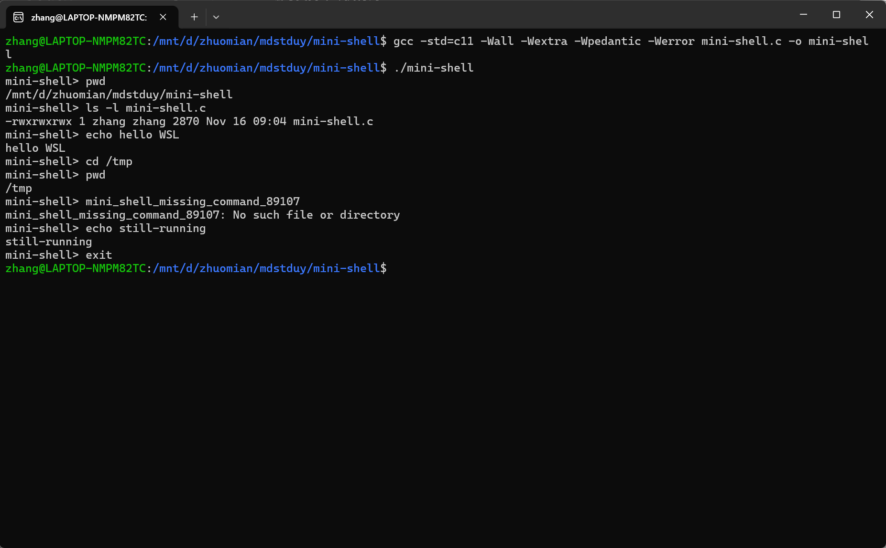
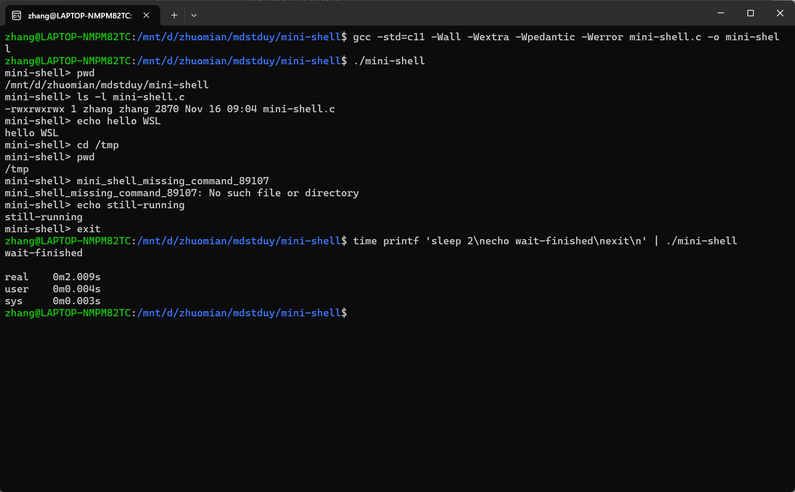
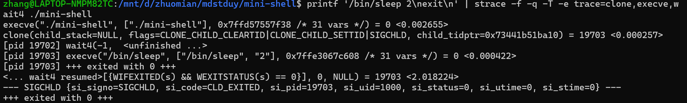

# 基于fork、exec和wait的简易Shell实验

在`mini-shell`目录编译并启动程序。

```bash
gcc -std=c11 -Wall -Wextra -Wpedantic -Werror mini-shell.c -o mini-shell
./mini-shell
```

图1中，`ls`列出源文件，`echo`打印`hello WSL`。`cd /tmp`执行后，`pwd`显示`/tmp`。输入不存在的命令后，Shell仍能执行`echo still-running`，最后通过`exit`返回Bash。



在Bash中依次向Shell输入`sleep 2`、`echo wait-finished`和`exit`，并记录整条管道的耗时。

```bash
time printf 'sleep 2\necho wait-finished\nexit\n' | ./mini-shell
```

图2输出`wait-finished`，实际耗时`real`为`0m2.009s`。



Shell按空白拆分输入。`cd`和`exit`由Shell直接处理，外部命令交给`run_command()`。在Bash中运行以下命令，追踪Shell及其子进程。

```bash
printf '/bin/sleep 2\nexit\n' | strace -f -q -T -e trace=clone,execve,wait4 ./mini-shell
```



图3中，Shell的PID为`19702`，子进程的PID为`19703`。`strace`显示的是C库接口实际使用的内核系统调用。

| 源码中的调用 | 在程序中的作用 | 图3对应的记录 |
| --- | --- | --- |
| 第50行`fork()` | 创建子进程。返回值为`0`时进入子进程分支，父进程得到子进程PID。 | `clone(...) = 19703`。 |
| 第56行`execvp(argv[0], argv)` | 在子进程中用目标程序替换原程序，PID保持不变。`execvp()`属于`exec`系列。 | `[pid 19703] execve("/bin/sleep", ...) = 0`。 |
| 第66行`wait(&status)` | 父进程等待子进程退出，取得退出状态后继续读取命令。 | `[pid 19702] wait4(-1, <unfinished ...>`进入等待，`<... wait4 resumed> ... = 19703 <2.018224>`表示等待结束，耗时2.018224秒。 |

图3开头的`execve("./mini-shell", ...)`记录的是实验Shell本身的启动。

## 完整源码

```c
#define _POSIX_C_SOURCE 200809L

#include <errno.h>
#include <stdio.h>
#include <stdlib.h>
#include <string.h>
#include <sys/wait.h>
#include <unistd.h>

enum { MAX_ARGS = 64 };

static int split_args(char *line, char *argv[])
{
    const char *delimiters = " \t\r\n";
    int argc = 0;

    for (char *word = strtok(line, delimiters); word != NULL;
         word = strtok(NULL, delimiters)) {
        if (argc == MAX_ARGS) {
            fprintf(stderr, "mini-shell: at most %d words per command\n", MAX_ARGS);
            return -1;
        }
        argv[argc++] = word;
    }
    argv[argc] = NULL;
    return argc;
}

static int change_directory(int argc, char *argv[])
{
    if (argc > 2) {
        fputs("usage: cd [directory]\n", stderr);
        return 2;
    }

    const char *directory = argc == 2 ? argv[1] : getenv("HOME");
    if (directory == NULL || *directory == '\0') {
        fputs("cd: HOME is not set\n", stderr);
        return 1;
    }
    if (chdir(directory) == -1) {
        perror("cd");
        return 1;
    }
    return 0;
}

static int run_command(char *argv[])
{
    pid_t child = fork();
    if (child == -1) {
        perror("fork");
        return 1;
    }
    if (child == 0) {
        execvp(argv[0], argv);
        int exit_code = errno == ENOENT ? 127 : 126;
        perror(argv[0]);
        _exit(exit_code);
    }

    /* 这个 Shell 每次只启动一个子进程，因此用 wait 即可。 */
    int status;
    pid_t finished;
    do {
        finished = wait(&status);
    } while (finished == -1 && errno == EINTR);

    if (finished == -1) {
        perror("wait");
        return 1;
    }
    if (WIFEXITED(status)) {
        return WEXITSTATUS(status);
    }
    return WIFSIGNALED(status) ? 128 + WTERMSIG(status) : 1;
}

int main(void)
{
    char *line = NULL;
    size_t capacity = 0;
    char *argv[MAX_ARGS + 1];
    int interactive = isatty(STDIN_FILENO);
    int last_status = 0;

    for (;;) {
        if (interactive) {
            fputs("mini-shell> ", stdout);
            fflush(stdout);
        }
        if (getline(&line, &capacity, stdin) == -1) {
            if (!feof(stdin)) {
                perror("getline");
                last_status = 1;
            }
            break;
        }

        int argc = split_args(line, argv);
        if (argc <= 0) {
            if (argc < 0) {
                last_status = 2;
            }
            continue;
        }
        if (strcmp(argv[0], "exit") == 0) {
            if (argc == 1) {
                break;
            }
            fputs("usage: exit\n", stderr);
            last_status = 2;
            continue;
        }
        if (strcmp(argv[0], "cd") == 0) {
            last_status = change_directory(argc, argv);
        } else {
            last_status = run_command(argv);
        }
    }

    free(line);
    return last_status;
}
```
