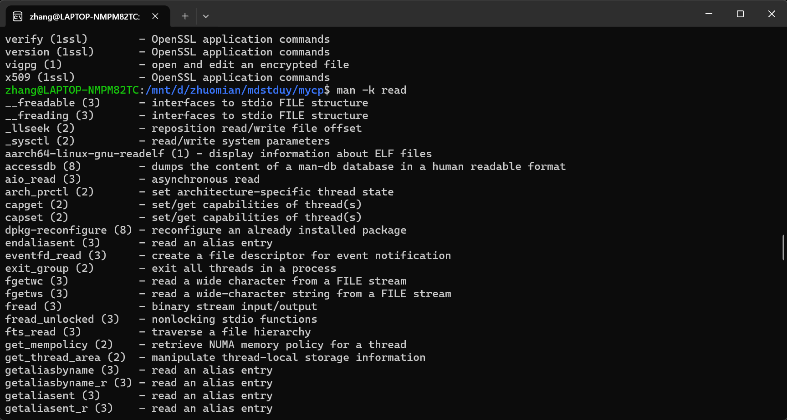
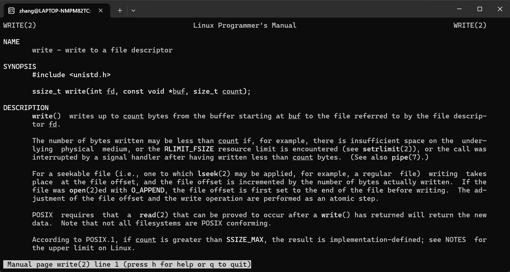
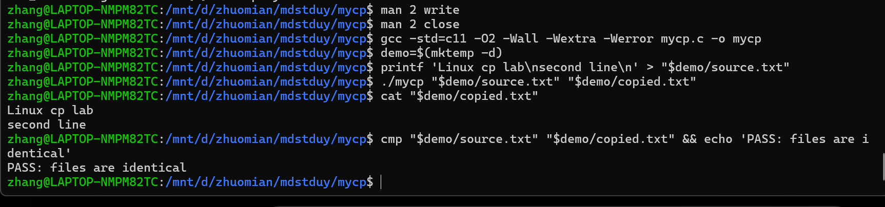

# 用系统调用实现cp

## 1. cp的功能

`cp`把文件复制到指定路径。目标为已有文件时，基本用法会覆盖其内容。目标为目录时，副本放在该目录中并沿用源文件名。系统`cp`还可复制多个源文件，并用`-R`递归复制目录。本实验的`mycp`实现单个普通文件的复制。[GNU Coreutils手册](https://www.gnu.org/software/coreutils/manual/html_node/cp-invocation.html)

## 2. 用man -k查找系统调用

在WSL的Ubuntu终端运行以下命令。`-k`按关键词查找手册条目，`-s 2`将搜索限定在系统调用章节。

```bash
man -k -s 2 '^(open|openat|read|write|fstat|ftruncate|close)$'
man 2 read
man 2 write
```

截图记录了用`man -k read`进行初步查询。结果包含多个手册章节。



| 接口 | 在程序中的作用 |
| --- | --- |
| `open()` | 只读打开源文件，以写入模式打开或创建目标文件 |
| `openat()` | 目标为目录时，以目录描述符为基准，按源文件名打开或创建副本 |
| `fstat()` | 查看文件类型，用设备号和inode号判断源文件与目标文件是否相同 |
| `ftruncate()` | 确认两个文件不同后清空目标文件，避免覆盖较长文件时留下旧数据 |
| `read()` | 从源文件分块读取，返回`0`表示读到文件末尾 |
| `write()` | 把已读内容写到目标文件，部分写入时继续写剩余字节 |
| `close()` | 关闭已打开的文件描述符 |

`write(2)`手册指出，实际写入的字节数可能少于参数`count`指定的字节数。



如果`man -k`搜不到第2节，先运行`sudo mandb`更新索引。如果`man 2 open`也提示没有手册页，可安装`manpages-dev`后重查。

## 3. 伪代码

```text
算法：mycp(源文件, 目标路径)

开始
    1. 检查命令行参数
       如果没有提供两个路径参数
           输出使用方法，返回失败
       将执行状态设为失败

    2. 用open()以只读方式打开源文件
       如果打开失败
           输出错误信息，返回失败

    3. 用fstat()检查源文件
       如果检查失败或源文件不是普通文件
           输出错误信息，转到第8步

    4. 用open()打开或创建目标文件，暂时保留原有内容
       如果打开失败且错误为EISDIR（目标是目录）
           打开目标目录
           如果目录打开成功
               用openat()在该目录中按源文件名打开或创建副本
               关闭目录
       如果没有取得目标文件描述符
           输出错误信息，转到第8步

    5. 用fstat()检查目标文件
       如果检查失败或目标文件不是普通文件
           输出错误信息，转到第8步
       如果源文件和目标文件的设备号与inode号均相同
           报告源文件和目标文件是同一个文件，转到第8步

    6. 用ftruncate()将目标文件长度设为0
       如果清空失败
           输出错误信息，转到第8步

    7. 循环复制数据
       用read()从源文件读取一块数据
       如果read()因EINTR失败
           重试读取
       如果发生其他读取错误
           输出错误信息，转到第8步
       如果read()返回0
           将执行状态设为成功，转到第8步

       将本块的已写入字节数设为0
       当本块还有剩余数据时
           用write()写入剩余字节
           如果write()因EINTR失败
               重试本次写入
           如果发生其他写入错误或write()返回0
               输出错误信息，转到第8步
           按write()实际返回的字节数更新写入位置

    8. 用close()关闭已打开的目标文件和源文件
       如果任一关闭操作失败
           输出错误信息，将执行状态设为失败

    9. 返回执行状态，成功返回0，失败返回非零值
结束
```

## 4. 实现代码及运行截图

### 编译与验证

在WSL的Ubuntu终端运行以下命令。测试文件由`mktemp`创建的临时目录存放。

```bash
cd /mnt/d/zhuomian/mdstduy/mycp
gcc -std=c11 -O2 -Wall -Wextra -Werror mycp.c -o mycp

demo=$(mktemp -d)
printf 'Linux cp lab\nsecond line\n' > "$demo/source.txt"
./mycp "$demo/source.txt" "$demo/copied.txt"
cat "$demo/copied.txt"
cmp "$demo/source.txt" "$demo/copied.txt" && echo 'PASS: files are identical'
```



截图中，`copied.txt`显示`Linux cp lab`和`second line`两行。`cmp`比较成功后，终端显示`PASS: files are identical`，说明副本与源文件逐字节一致。

### C源码

```c
#define _GNU_SOURCE

#include <errno.h>
#include <fcntl.h>
#include <stdio.h>
#include <stdlib.h>
#include <string.h>
#include <sys/stat.h>
#include <unistd.h>

static int open_destination(const char *source, const char *target, mode_t mode)
{
    int flags = O_WRONLY | O_CREAT | O_NONBLOCK;
    int output = open(target, flags, mode);
    if (output != -1 || errno != EISDIR) {
        return output;
    }

    int directory = open(target, O_PATH | O_DIRECTORY);
    if (directory == -1) {
        return -1;
    }

    const char *last_slash = strrchr(source, '/');
    const char *name = last_slash == NULL ? source : last_slash + 1;
    output = openat(directory, name, flags, mode);
    int open_error = errno;
    close(directory);
    errno = open_error;
    return output;
}

static int copy_contents(int input, int output)
{
    char buffer[65536];

    for (;;) {
        ssize_t count = read(input, buffer, sizeof buffer);
        if (count == -1) {
            if (errno == EINTR) {
                continue;
            }
            return -1;
        }
        if (count == 0) {
            return 0;
        }

        size_t written = 0;
        while (written < (size_t)count) {
            ssize_t chunk = write(output, buffer + written, (size_t)count - written);
            if (chunk == -1) {
                if (errno == EINTR) {
                    continue;
                }
                return -1;
            }
            if (chunk == 0) {
                errno = EIO;
                return -1;
            }
            written += (size_t)chunk;
        }
    }
}

int main(int argc, char *argv[])
{
    if (argc != 3) {
        fprintf(stderr, "Usage: %s SOURCE DESTINATION\n", argv[0]);
        return EXIT_FAILURE;
    }

    int input = open(argv[1], O_RDONLY | O_NONBLOCK);
    if (input == -1) {
        perror(argv[1]);
        return EXIT_FAILURE;
    }

    int output = -1;
    int status = EXIT_FAILURE;
    struct stat source_info;
    struct stat target_info;

    if (fstat(input, &source_info) == -1) {
        perror("mycp: fstat source");
        goto cleanup;
    }
    if (!S_ISREG(source_info.st_mode)) {
        fputs("mycp: source must be a regular file\n", stderr);
        goto cleanup;
    }

    mode_t permissions = source_info.st_mode & (S_IRWXU | S_IRWXG | S_IRWXO);
    output = open_destination(argv[1], argv[2], permissions);
    if (output == -1) {
        perror(argv[2]);
        goto cleanup;
    }
    if (fstat(output, &target_info) == -1) {
        perror("mycp: fstat destination");
        goto cleanup;
    }
    if (!S_ISREG(target_info.st_mode)) {
        fputs("mycp: destination must resolve to a regular file\n", stderr);
        goto cleanup;
    }
    if (source_info.st_dev == target_info.st_dev &&
        source_info.st_ino == target_info.st_ino) {
        fputs("mycp: source and destination refer to the same file\n", stderr);
        goto cleanup;
    }

    /* Check file identity before truncating the destination. */
    if (ftruncate(output, 0) == -1) {
        perror("mycp: truncate destination");
        goto cleanup;
    }
    if (copy_contents(input, output) == -1) {
        perror("mycp: copy");
        goto cleanup;
    }
    status = EXIT_SUCCESS;

cleanup:
    if (output != -1 && close(output) == -1) {
        perror("mycp: close destination");
        status = EXIT_FAILURE;
    }
    if (close(input) == -1) {
        perror("mycp: close source");
        status = EXIT_FAILURE;
    }
    return status;
}
```
