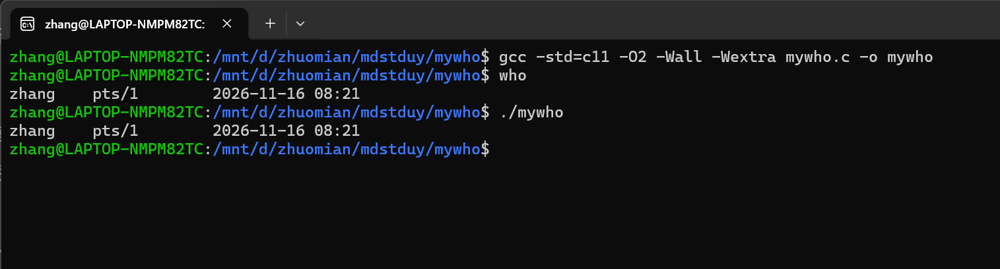

# 用系统调用实现mywho

`mywho`实现无参数`who`的基本功能。程序用`open()`、`read()`和`close()`读取`/var/run/utmp`中的登录记录，筛选有效的`USER_PROCESS`记录，输出用户名、终端、登录时间以及存在时的远程主机。

登录时间取自记录的`ut_tv.tv_sec`。程序用`localtime_r()`转换为本地时间，再用`strftime()`按当前语言环境的时间格式输出。本次实验的格式为`%Y-%m-%d %H:%M`。

## 运行结果

在WSL 2的Ubuntu 22.04终端进入`mywho.c`所在目录，执行以下命令。

```bash
gcc -std=c11 -O2 -Wall -Wextra mywho.c -o mywho
who
./mywho
```



图中两个命令都显示用户`zhang`、终端`pts/1`和登录时间`2026-11-16 08:21`。

## C源码

```c
#define _DEFAULT_SOURCE

#include <errno.h>
#include <fcntl.h>
#include <locale.h>
#include <signal.h>
#include <stdio.h>
#include <stdlib.h>
#include <string.h>
#include <time.h>
#include <unistd.h>
#include <utmp.h>

/* Return 1 for a complete record, 0 at EOF, or -1 on error. */
static int read_record(int fd, struct utmp *record)
{
    unsigned char *buffer = (unsigned char *)record;
    size_t filled = 0;

    while (filled < sizeof *record) {
        ssize_t count = read(fd, buffer + filled, sizeof *record - filled);
        if (count > 0) {
            filled += (size_t)count;
        } else if (count == 0) {
            if (filled == 0) {
                return 0;
            }
            errno = EIO;
            return -1;
        } else if (errno != EINTR) {
            return -1;
        }
    }
    return 1;
}

static int print_login(const struct utmp *record, const char *time_format)
{
    time_t login_time = record->ut_tv.tv_sec;
    struct tm local_time;
    char timestamp[64];

    if (localtime_r(&login_time, &local_time) == NULL ||
        strftime(timestamp, sizeof timestamp, time_format, &local_time) == 0) {
        fputs("mywho: could not format the login time\n", stderr);
        return -1;
    }

    /* A full utmp field may have no terminating NUL. */
    printf("%-8.*s %-12.*s %s",
           (int)sizeof record->ut_user, record->ut_user,
           (int)sizeof record->ut_line, record->ut_line, timestamp);
    if (record->ut_host[0] != '\0') {
        printf(" (%.*s)", (int)sizeof record->ut_host, record->ut_host);
    }
    putchar('\n');
    return 0;
}

int main(void)
{
    setlocale(LC_ALL, "");
    const char *time_locale = setlocale(LC_TIME, NULL);
    const char *time_format = "%Y-%m-%d %H:%M";
    if (strcmp(time_locale, "C") == 0 || strcmp(time_locale, "POSIX") == 0) {
        time_format = "%b %e %H:%M";
    }

    int fd = open(UTMP_FILE, O_RDONLY);
    if (fd == -1) {
        perror("mywho: open " UTMP_FILE);
        return EXIT_FAILURE;
    }

    struct utmp record;
    int read_status;
    int status = EXIT_SUCCESS;

    while ((read_status = read_record(fd, &record)) == 1) {
        if (record.ut_type != USER_PROCESS || record.ut_user[0] == '\0') {
            continue;
        }
        /* Signal 0 checks whether the login process still exists. */
        if (record.ut_pid > 0 && kill(record.ut_pid, 0) == -1 && errno == ESRCH) {
            continue;
        }
        if (print_login(&record, time_format) == -1) {
            status = EXIT_FAILURE;
            break;
        }
    }
    if (read_status == -1) {
        perror("mywho: read " UTMP_FILE);
        status = EXIT_FAILURE;
    }
    if (close(fd) == -1) {
        perror("mywho: close " UTMP_FILE);
        status = EXIT_FAILURE;
    }
    if (fflush(stdout) == EOF || ferror(stdout)) {
        fputs("mywho: could not write the output\n", stderr);
        status = EXIT_FAILURE;
    }
    return status;
}
```
