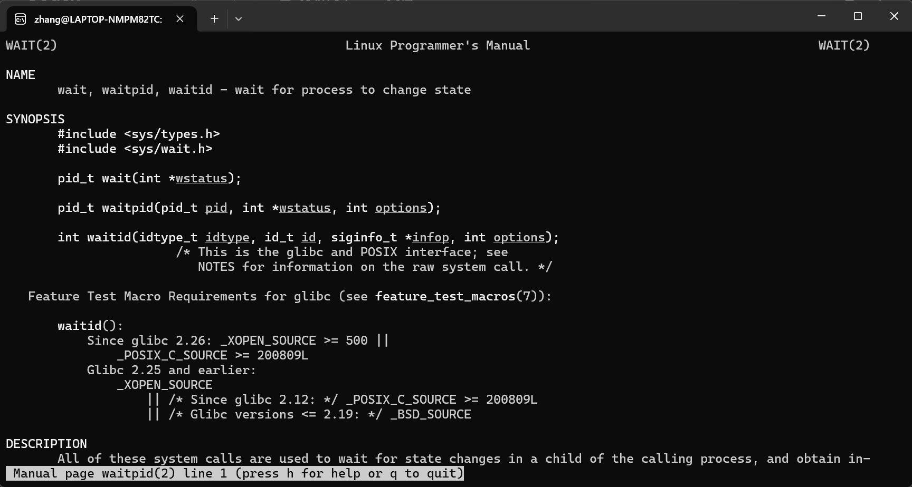
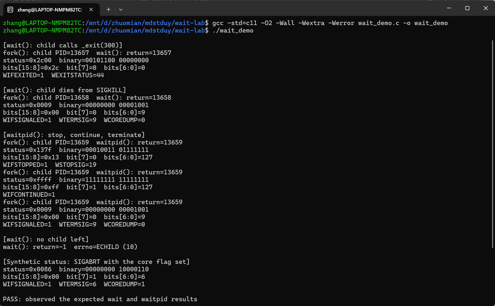

# wait与waitpid实验

## 1. 阅读man手册

在WSL的Ubuntu终端运行以下命令。可在手册中搜索`RETURN VALUE`查看返回值，按`q`返回终端。

```bash
man wait
man waitpid
```



截图顶部的`WAIT(2)`是手册标题，底部的`waitpid(2)`是本次查询的名称。`man -k -s 2 '^(wait|waitpid)$'`会列出两个查找入口。分别运行`man -w wait`和`man -w waitpid`，在本机WSL中均得到`/usr/share/man/man2/wait.2.gz`。

- `wait(&status)`等价于`waitpid(-1, &status, 0)`，默认等待任一子进程终止。成功返回对应的子进程PID，失败返回`-1`并设置`errno`。子进程状态通过`status`传出。
- `waitpid(pid, &status, options)`可用正数`pid`指定一个子进程，用`-1`等待任一子进程。`WUNTRACED`可取得暂停状态，`WCONTINUED`可取得继续状态。指定`WNOHANG`时，如果有符合条件的子进程但暂时没有可报告的状态，调用立即返回`0`。

## 2. Linux等待状态的位含义

这里拆解的是传出的`int status`。从最低位开始编号，最低位为第0位。表中的普通子进程状态用低16位编码，本次观察的值高16位均为0。程序先用`WIF*()`宏判断状态，再用对应的宏读取字段。位掩码可在本机glibc的`bits/waitstatus.h`中查看。

| 状态 | 第15～8位 | 第7位 | 第6～0位 | 解码宏 |
| --- | --- | --- | --- | --- |
| 正常退出 | 传给`_exit()`的值的低8位 | 0 | 全0 | `WIFEXITED`、`WEXITSTATUS` |
| 被信号终止 | 0 | 是否产生核心转储，1表示已产生 | 终止信号编号 | `WIFSIGNALED`、`WTERMSIG`、`WCOREDUMP` |
| 暂停 | 导致暂停的信号编号 | 0 | 全1，低字节合为`0x7f` | `WIFSTOPPED`、`WSTOPSIG` |
| 继续 | 全1 | 1 | 全1，整个状态为`0xffff` | `WIFCONTINUED` |

第15～8位作为8位数解读时，从高到低的权重是128、64、32、16、8、4、2、1。第6～0位作为7位数解读时，权重是64、32、16、8、4、2、1。第7位只在信号终止的状态下解释为core标志。

## 3. 编译与实测

```bash
cd /mnt/d/zhuomian/mdstduy/wait-lab
gcc -std=c11 -O2 -Wall -Wextra -Werror wait_demo.c -o wait_demo
./wait_demo
```



| 测试 | 调用 | WSL实际状态值 | 解码结果 |
| --- | --- | --- | --- |
| 子进程调用`_exit(300)` | `wait()` | `0x2c00` | `WEXITSTATUS=44`，因为`300 & 0xff`等于44 |
| 子进程被`SIGKILL`终止 | `wait()` | `0x0009` | `WTERMSIG=9`，`WCOREDUMP=0` |
| 子进程因`SIGSTOP`暂停 | `waitpid()` | `0x137f` | `WSTOPSIG=19` |
| 子进程收到`SIGCONT`后继续 | `waitpid()` | `0xffff` | `WIFCONTINUED=1` |
| 子进程均已回收后再次等待 | `wait()` | 无可解码的状态 | 返回`-1`，`errno=ECHILD` |

运行截图中，`_exit(300)`这一组的子进程PID为`13657`，`wait()`同样返回`13657`。`status`的二进制为`00101100 00000000`，高字节的三个置位相加得到`32 + 8 + 4 = 44`。`SIGKILL`这一组的二进制为`00000000 00001001`，低7位的置位相加得到`8 + 1 = 9`。

程序另外用构造的`0x0086`演示第7位。低7位为6，对应`SIGABRT`，第7位为1，解码得到`WCOREDUMP=1`。

## 4. C测试代码

```c
#define _DEFAULT_SOURCE

#include <errno.h>
#include <signal.h>
#include <stdio.h>
#include <stdlib.h>
#include <sys/wait.h>
#include <unistd.h>

static void print_status(int status)
{
    unsigned int bits = (unsigned int)status;

    printf("status=0x%04x  binary=", bits);
    for (int bit = 15; bit >= 0; --bit) {
        if (bit == 7) {
            putchar(' ');
        }
        putchar((bits & (1u << bit)) != 0 ? '1' : '0');
    }
    printf("\nbits[15:8]=0x%02x  bit[7]=%u  bits[6:0]=%u\n",
           (bits >> 8) & 0xffu, (bits >> 7) & 1u, bits & 0x7fu);

    if (WIFEXITED(status)) {
        printf("WIFEXITED=1  WEXITSTATUS=%d\n", WEXITSTATUS(status));
    } else if (WIFSIGNALED(status)) {
        printf("WIFSIGNALED=1  WTERMSIG=%d  WCOREDUMP=%d\n",
               WTERMSIG(status), WCOREDUMP(status) ? 1 : 0);
    } else if (WIFSTOPPED(status)) {
        printf("WIFSTOPPED=1  WSTOPSIG=%d\n", WSTOPSIG(status));
    } else if (WIFCONTINUED(status)) {
        puts("WIFCONTINUED=1");
    }
}

static pid_t wait_retry(int *status)
{
    pid_t result;
    do {
        result = wait(status);
    } while (result == -1 && errno == EINTR);
    return result;
}

static pid_t waitpid_retry(pid_t child, int *status, int options)
{
    pid_t result;
    do {
        result = waitpid(child, status, options);
    } while (result == -1 && errno == EINTR);
    return result;
}

static int test_wait(const char *label, int exit_code, int fatal_signal)
{
    pid_t child = fork();
    if (child == -1) {
        perror("fork");
        return -1;
    }
    if (child == 0) {
        if (fatal_signal != 0) {
            raise(fatal_signal);
        }
        _exit(exit_code);
    }

    int status;
    pid_t result = wait_retry(&status);
    if (result == -1) {
        perror("wait");
        return -1;
    }

    printf("\n[%s]\nfork(): child PID=%ld  wait(): return=%ld\n",
           label, (long)child, (long)result);
    print_status(status);
    if (result != child) {
        return -1;
    }
    if (fatal_signal != 0) {
        return WIFSIGNALED(status) && WTERMSIG(status) == fatal_signal ? 0 : -1;
    }
    return WIFEXITED(status) && WEXITSTATUS(status) == (exit_code & 0xff) ? 0 : -1;
}

static int test_waitpid(void)
{
    pid_t child = fork();
    if (child == -1) {
        perror("fork");
        return -1;
    }
    if (child == 0) {
        raise(SIGSTOP);
        for (;;) {
            pause();
        }
    }

    int stopped = 0;
    int continued = 0;
    puts("\n[waitpid(): stop, continue, terminate]");
    for (;;) {
        int status;
        pid_t result = waitpid_retry(child, &status, WUNTRACED | WCONTINUED);
        if (result == -1) {
            perror("waitpid");
            return -1;
        }

        printf("fork(): child PID=%ld  waitpid(): return=%ld\n",
               (long)child, (long)result);
        print_status(status);

        int next_signal;
        if (WIFSTOPPED(status)) {
            stopped = WSTOPSIG(status) == SIGSTOP;
            next_signal = SIGCONT;
        } else if (WIFCONTINUED(status)) {
            continued = 1;
            next_signal = SIGKILL;
        } else {
            return stopped && continued &&
                   WIFSIGNALED(status) && WTERMSIG(status) == SIGKILL ? 0 : -1;
        }

        if (kill(child, next_signal) == -1) {
            perror("kill");
            if (kill(child, SIGKILL) == 0 || errno == ESRCH) {
                waitpid_retry(child, NULL, 0);
            }
            return -1;
        }
    }
}

int main(void)
{
    if (test_wait("wait(): child calls _exit(300)", 300, 0) == -1 ||
        test_wait("wait(): child dies from SIGKILL", 0, SIGKILL) == -1 ||
        test_waitpid() == -1) {
        fputs("FAIL: unexpected child state\n", stderr);
        return EXIT_FAILURE;
    }

    errno = 0;
    pid_t result = wait_retry(NULL);
    if (result != -1 || errno != ECHILD) {
        fputs("FAIL: wait() should report ECHILD\n", stderr);
        return EXIT_FAILURE;
    }
    printf("\n[wait(): no child left]\nwait(): return=%ld  errno=ECHILD (%d)\n",
           (long)result, errno);

    puts("\n[Synthetic status: SIGABRT with the core flag set]");
    print_status(0x80 | SIGABRT);

    puts("\nPASS: observed the expected wait and waitpid results");
    return EXIT_SUCCESS;
}
```
