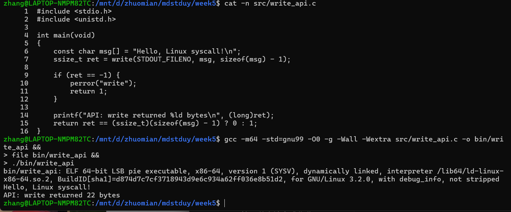
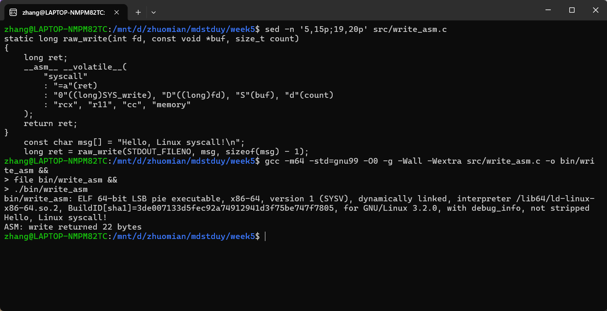
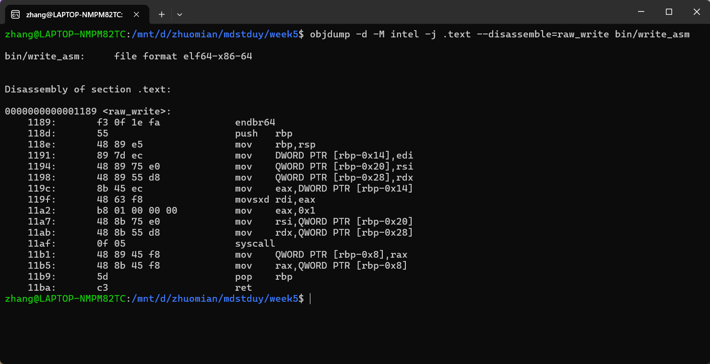

# 使用库函数API和C内嵌汇编调用write系统调用

作者：张骞  
学号：20262811

## 一、实验目的与环境

本实验选择`write`系统调用，分别通过库函数API和C内嵌汇编向标准输出写入同一段文字，比较运行结果，重点分析系统调用号、参数和返回值怎样在用户程序与内核之间传递。

本次使用WSL2中的Ubuntu22.04.3LTS，内核版本为`6.6.87.2-microsoft-standard-WSL2`，处理器架构为`x86_64`，GCC版本为11.4.0。

两份程序均编译为64位ELF文件，采用x86-64系统调用约定，通过`syscall`指令进入内核。[Linux man-pages：syscall(2)](https://man7.org/linux/man-pages/man2/syscall.2.html)

相关命令和输出另存于[运行日志](logs/records.json)，终端中的源码、编译运行结果和反汇编分别见图1至图3。

## 二、通过库函数API调用write

`write(fd, buf, count)`向文件描述符`fd`对应的对象写入`buf`中的数据。成功时返回实际写入的字节数，出错时返回`-1`并设置`errno`。[Linux man-pages：write(2)](https://man7.org/linux/man-pages/man2/write.2.html)

完整代码见[write_api.c](src/write_api.c)，代码和运行记录见图1。

在`week5`目录中编译运行：

```bash
gcc -m64 -std=gnu99 -O0 -g -Wall -Wextra src/write_api.c -o bin/write_api
./bin/write_api
```



运行时输出`Hello, Linux syscall!`，随后显示`API: write returned 22 bytes`。

`STDOUT_FILENO`的值为`1`，表示标准输出。`sizeof(msg) - 1`排除结尾的`\0`并保留换行符，因此请求写入22字节。本次返回22，完成了全部请求；一般情况下仍可能发生部分写入。

## 三、通过C内嵌汇编调用write

完整代码见[write_asm.c](src/write_asm.c)。程序用相同参数调用`raw_write()`，核心函数和调用位置见图2。

`"=a"`接收返回值，`"0"`复用该寄存器传入调用号；`"D"`、`"S"`、`"d"`传入三个参数。`rcx`、`r11`等修改声明和`memory`约束用于告知编译器汇编的影响。[GNU GCC：扩展汇编](https://gcc.gnu.org/onlinedocs/gcc/Extended-Asm.html)

编译运行：

```bash
gcc -m64 -std=gnu99 -O0 -g -Wall -Wextra src/write_asm.c -o bin/write_asm
./bin/write_asm
```



两种方式均输出相同文字并返回22。`raw_write()`读取原始返回值，用`ret < 0`判断失败，需要自行处理错误；它没有实现库函数将错误转换为`-1`并设置`errno`的处理。

## 四、系统调用的工作过程与参数传递

Linux6.6源码中的x86-64系统调用表有`1 common write sys_write`，即`write`的调用号为`1`。调用号用于选择内核服务，文件描述符用于指定写入对象，二者在本例中恰好都为`1`。[Linuxv6.6：syscall_64.tbl](https://github.com/torvalds/linux/blob/v6.6/arch/x86/entry/syscalls/syscall_64.tbl)

本次调用的寄存器分工如下：

| 内容 | 寄存器 | 本次传入或返回的值 |
| --- | --- | --- |
| 系统调用号 | `rax` | `1`，选择`write` |
| 第1个参数`fd` | `rdi` | `1`，标准输出 |
| 第2个参数`buf` | `rsi` | `msg`的首地址 |
| 第3个参数`count` | `rdx` | `22`，即`0x16` |
| 返回值 | `rax` | 本次成功写入的字节数`22` |

三个参数依次经`rdi`、`rsi`、`rdx`传递；`buf`传递的是用户缓冲区地址。[Linux man-pages：架构调用约定](https://man7.org/linux/man-pages/man2/syscall.2.html#NOTES)

使用反汇编查看`raw_write()`：

```bash
objdump -d -M intel -j .text --disassemble=raw_write bin/write_asm
```



图3中，`mov eax,0x1`设置系统调用号，随后将缓冲区地址和长度放入`rsi`、`rdx`，执行`syscall`；返回后，再把`rax`中的结果保存到局部变量。结合接口约定，调用过程可整理为：

```text
用户程序准备fd、buf和count
  → 库函数write或内嵌汇编准备系统调用寄存器
  → 执行syscall，从用户态进入内核态
  → 内核根据调用号选择write的处理流程
  → 检查参数并执行写入，将结果放入rax
  → 返回用户态，程序继续处理返回值
```

调用`raw_write()`本身仍在用户态执行，执行到`syscall`时才进入内核。本实验没有逐步跟踪内核入口，内核分派与写入过程依据接口约定和源码分析。

## 五、对系统调用工作机制的理解

我对本次实验的理解主要有三点：

1. **库函数封装了底层细节。** 两种方式都请求内核执行`write`，库函数更方便，内嵌汇编使参数准备过程更加直观。
2. **寄存器约定是用户程序与内核之间的接口。** 调用号、缓冲区地址、长度和返回值各有规定的位置，必须与当前架构一致。
3. **运行结果需要结合返回值判断。** 本次两种实现均写入22字节，但实际编程仍需处理错误和部分写入，并区分实际观察与资料分析。
