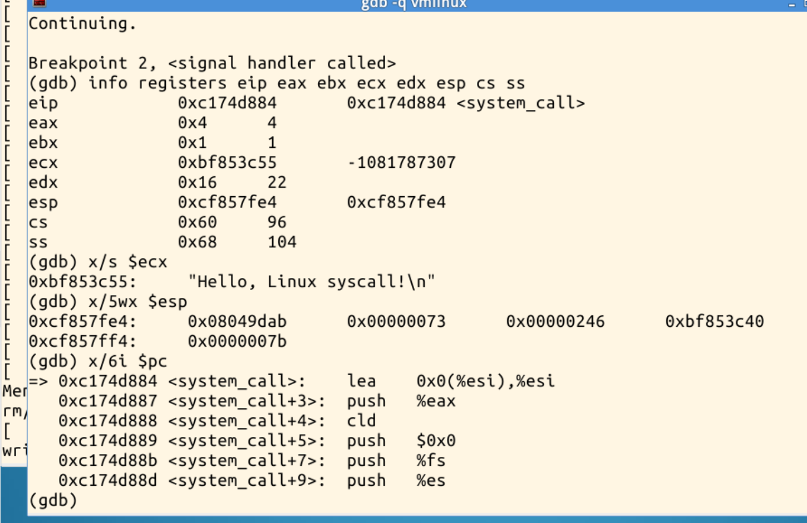
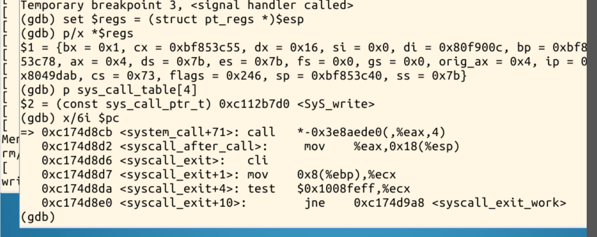
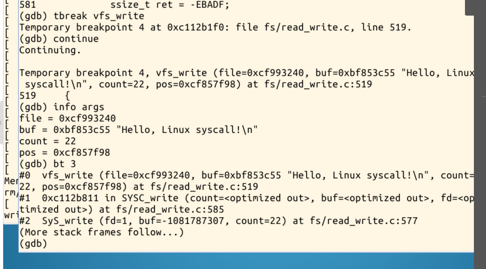
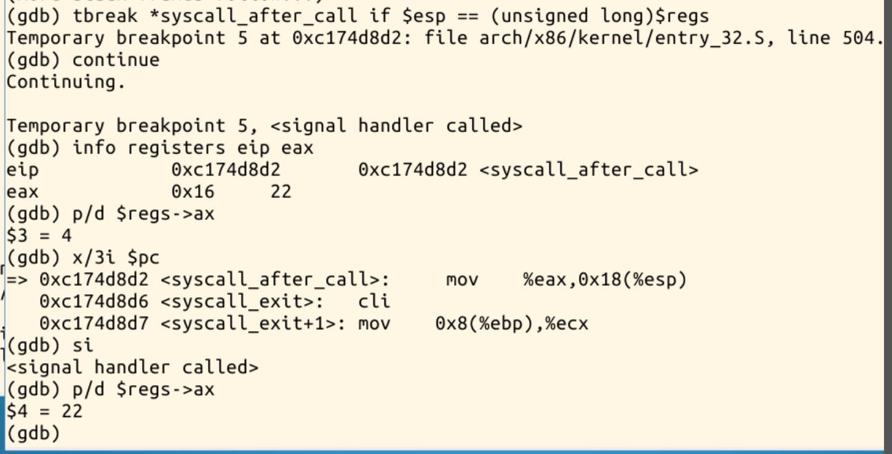
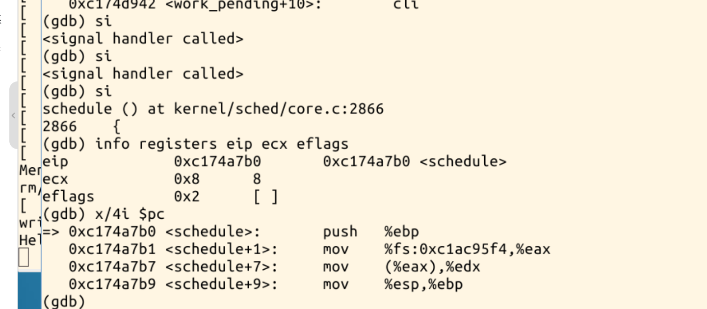
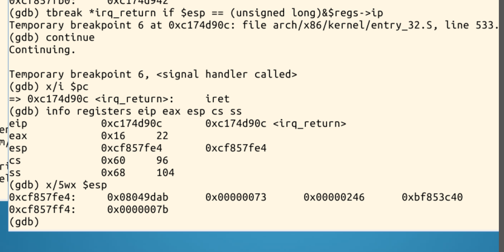
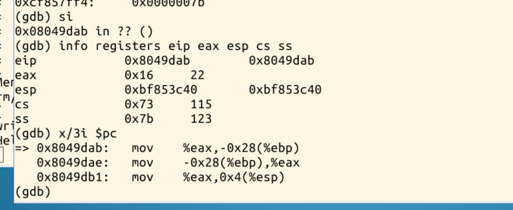
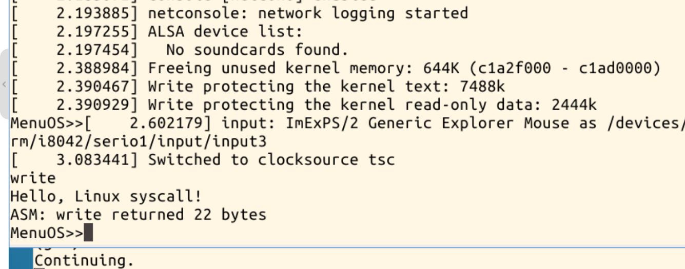
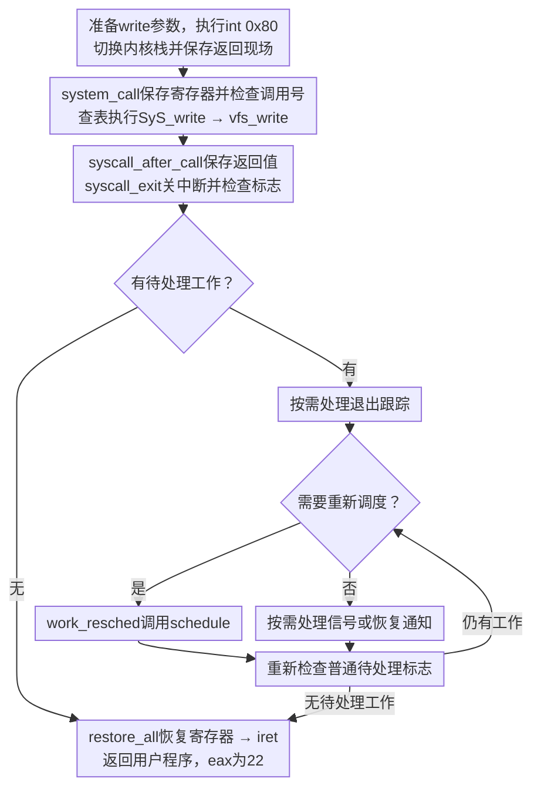

# 从write系统调用跟踪system_call到iret的处理过程

## 一、从system_call进入write内核函数

### 1. 进入内核并保存现场

本次停在`system_call`入口`0xc174d884`。`eax=4`、`ebx=1`、`edx=22`，`ecx`指向的字符串与测试程序一致。

此时已切换到内核栈，`cs=0x60`、`ss=0x68`。栈顶保存用户态的`EIP、CS、EFLAGS、ESP、SS`，其中`EIP=0x08049dab`，对应`int`之后的位置。



入口保存原始调用号与寄存器，形成`pt_regs`，再获取线程信息并检查入口条件。合法调用通过系统调用表分派，越界调用走错误返回。关键汇编如下，省略了跟踪等分支。[入口源码](https://github.com/gregkh/linux/blob/v3.18.6/arch/x86/kernel/entry_32.S)

```asm
pushl_cfi %eax
SAVE_ALL
GET_THREAD_INFO(%ebp)
cmpl $(NR_syscalls), %eax
jae syscall_badsys
call *sys_call_table(,%eax,4)
movl %eax,PT_EAX(%esp)
```

在`syscall_call`处，保存的参数与入口一致，`orig_ax=4`。间接`call`按`eax`索引，每个表项占4字节；本次`sys_call_table[4]`指向`0xc112b7d0 <SyS_write>`。



### 2. 执行内核写入处理

进入`SyS_write`后，参数仍为`fd=1`、`buf=0xbf853c55`、`count=22`。保存的`ebx`、`ecx`、`edx`在栈中连续排列；`call`压入返回地址后，C入口按栈取参。`SYSCALL_DEFINE3`宏生成相应封装，对应`SyS_write`与`SYSC_write`等名称。[宏定义](https://github.com/gregkh/linux/blob/v3.18.6/include/linux/syscalls.h)

继续跟踪时，调用栈显示`SyS_write → SYSC_write → vfs_write`。结合源码，内核先按文件描述符取得文件对象，再由`vfs_write`检查写入能力、用户缓冲区范围等条件，调用文件对应的写入操作。本实验实际跟踪到`vfs_write`。[write与vfs_write源码](https://github.com/gregkh/linux/blob/v3.18.6/fs/read_write.c)



### 3. 将返回值保存到现场

返回`syscall_after_call`时，`eax=22`，但保存现场中的`ax`仍为进入时的`4`。执行`mov %eax,0x18(%esp)`后，`pt_regs.ax`变为22，使后续恢复寄存器时取得写入结果；`orig_ax`仍保留原始调用号。



## 二、返回前的调度检查与iret

`syscall_exit`先关闭中断并读取线程标志，避免在检查与返回之间遗漏待处理状态，再决定是否进入额外处理分支。

本次读取到`flags=0x8`，对应第3位`TIF_NEED_RESCHED`，说明需要重新调度。[标志检查截图](image/reschedule-flag.png)

随后实际停在`schedule()`入口。对应源码在`work_pending`检查重新调度标志，在`work_resched`调用`schedule`；恢复执行后再次检查待处理标志，必要时处理调度、信号等工作，最后恢复现场。[返回路径源码](https://github.com/gregkh/linux/blob/v3.18.6/arch/x86/kernel/entry_32.S)



本次确认进入了调度函数，但未继续记录任务切换，不能据此断言已经换成另一个任务。是否调度取决于当时的标志，不能推广为每次系统调用结束都会调度。

在`irq_return`处，实际指令为`iret`。此时通用寄存器已经恢复，`eax=22`，栈顶仍是原来的五个用户态返回字段。



单步执行`iret`后，`eip=0x08049dab`、`esp=0xbf853c40`，`cs=0x73`、`ss=0x7b`，`eax`仍为22，下一条用户指令将它保存到局部变量。恢复的值与入口现场一致，验证了返回用户态的过程。



继续运行后，MenuOS显示`Hello, Linux syscall!`和`ASM: write returned 22 bytes`，随后重新出现命令提示符。终端输出与GDB观察到的返回值一致。



本次正常调用的主要流程如下，入口跟踪、退出跟踪、信号与异常修复的细节予以合并说明：

<style>
.week6-flowchart, .week6-flowchart .mermaid {
  height: auto !important;
  min-height: 0 !important;
  margin: 12px auto;
  break-inside: avoid;
  page-break-inside: avoid;
}
.week6-flowchart svg {
  display: block;
  width: auto !important;
  height: auto !important;
  max-width: 100% !important;
  max-height: 650px !important;
  margin: 0 auto;
}
@media print {
  body p { break-inside: avoid; page-break-inside: avoid; }
}
</style>

<div class="week6-flowchart">



</div>

## 三、对系统调用与中断处理过程的理解

1. 系统调用入口把用户程序的参数转换为内核可处理的现场，并按调用号选择服务。调用C函数只是其中一段，现场保存和恢复同样不可缺少。
2. 返回用户态前还要检查待处理工作。本次观察到重新调度标志与`schedule`入口，说明写入完成并不意味着立即执行`iret`；返回结果则通过保存现场跨越这段处理过程。
3. 系统调用与一般中断、异常处理具有保存现场、执行处理和恢复现场的共同结构，但触发来源和处理规则不同。本例的`int $0x80`由用户程序同步发起，不能把它与外部设备产生的异步中断完全等同。

