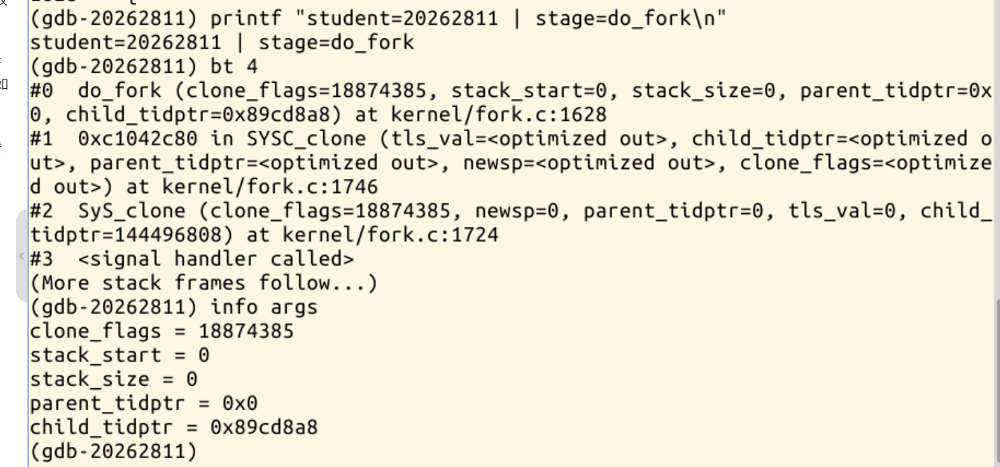
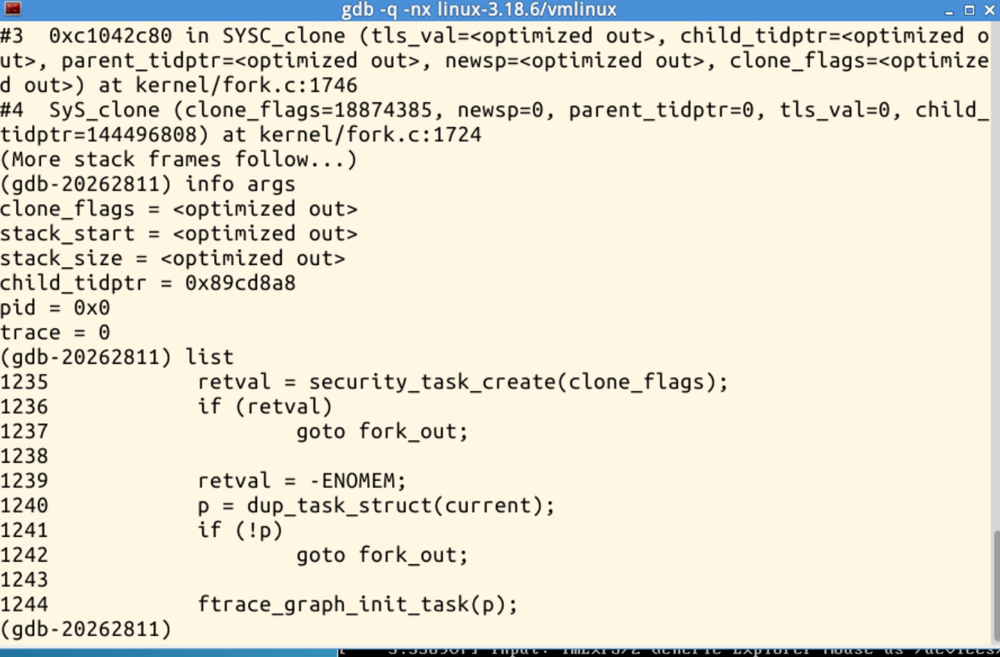
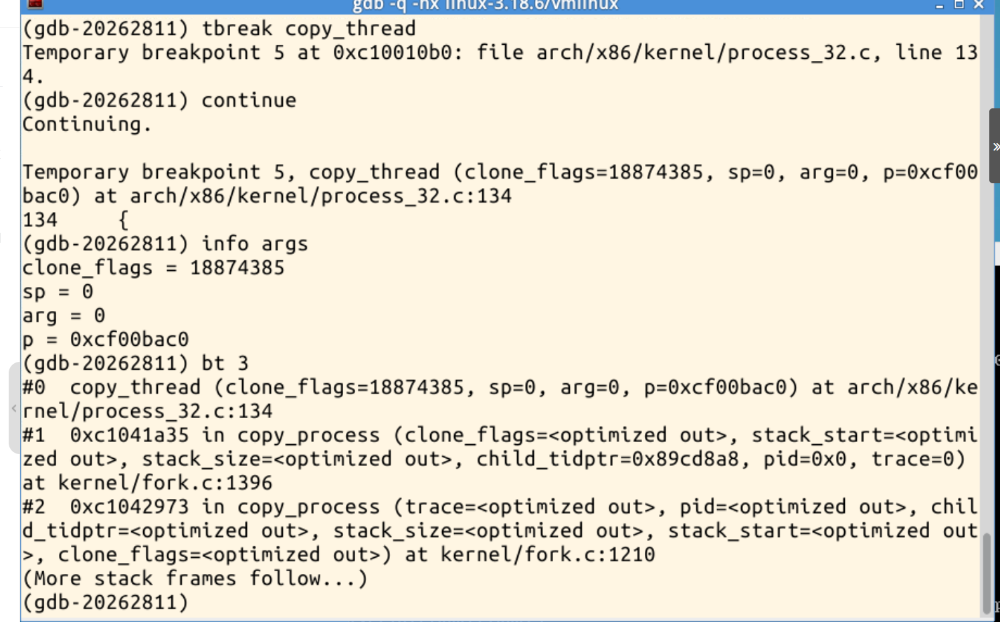
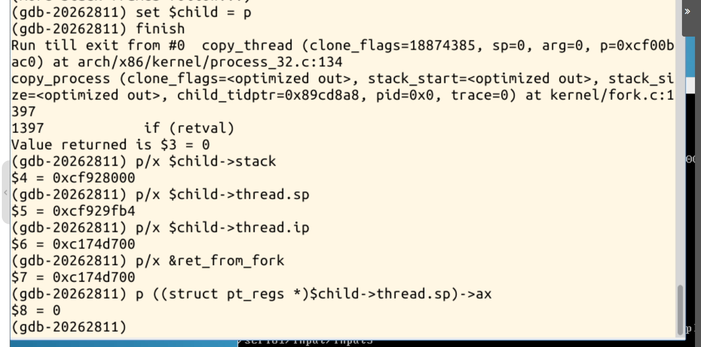
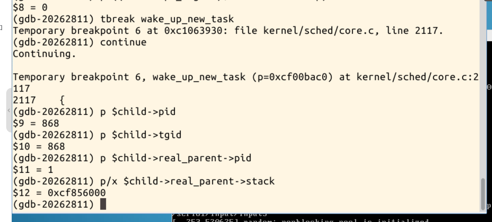
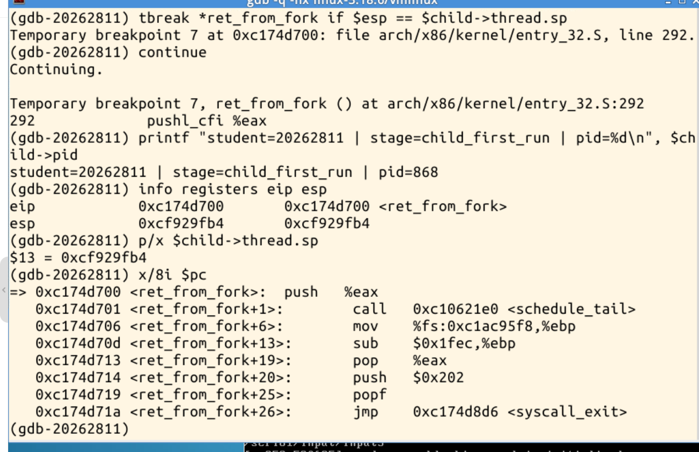
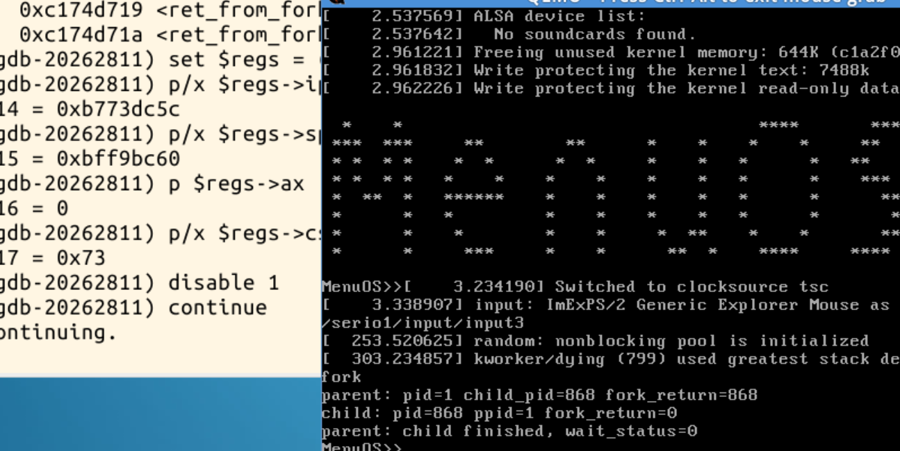

# 20262811《Linux内核原理与分析》进程创建过程分析

在课程提供的32位Linux3.18.6环境中，使用GDB跟踪一次`fork()`，观察新任务的创建、内核栈准备、首次调度和返回用户态的过程。

## 一、从fork进入内核

用户程序调用`fork()`后，进入clone系统调用处理过程。GDB调用栈显示`SyS_clone → SYSC_clone → do_fork`，本次创建标志为`0x1200011`。

## 二、创建新任务

`do_fork`调用`copy_process`，其中通过`dup_task_struct(current)`分配并复制任务结构。部分局部变量显示`<optimized out>`，表示调试信息无法恢复其值，不能据此判断分配失败。

继续进入`copy_thread`，实参`p=0xcf00bac0`是本次新任务的`task_struct`地址。调用栈确认它由`copy_process`调用，用于设置新任务的体系结构相关执行上下文。

## 三、准备内核栈和执行入口

`copy_thread`返回0。新任务的内核栈基址为`0xcf928000`，初始内核栈指针`thread.sp=0xcf929fb4`。`thread.ip=0xc174d700`与`ret_from_fork`地址一致，栈上保存的`pt_regs.ax=0`，为子进程返回0准备好寄存器状态。

这里的`thread.sp`指向新内核栈上准备好的`pt_regs`现场。源码中的[copy_thread](https://github.com/gregkh/linux/blob/v3.18.6/arch/x86/kernel/process_32.c#L132)会复制父任务保存的用户态寄存器，把其中的`ax`改为0，并设置`thread.ip`。这样，新任务就具备了系统调用返回路径所需要的寄存器现场。

## 四、分配PID并准备调度

在`wake_up_new_task`入口，新任务指针仍为`0xcf00bac0`，PID与TGID均已设置为868，父进程PID为1。父进程内核栈基址为`0xcf856000`，与子进程的`0xcf928000`不同，说明父子使用各自的内核栈。随后由该函数将新任务加入调度运行队列。

## 五、验证首次调度的执行起点

在`ret_from_fork`入口命中条件断点时，CPU实际使用的`eip=0xc174d700`、`esp=0xcf929fb4`，分别与准备好的入口地址和内核栈指针一致。反汇编显示，接下来调用`schedule_tail`完成调度收尾，再跳转到`syscall_exit`。

入口与栈能够配合，是因为本版本32位内核的[switch_to](https://github.com/gregkh/linux/blob/v3.18.6/arch/x86/include/asm/switch_to.h#L39)会把新任务的`thread.sp`装入CPU的`esp`，并把`thread.ip`压入新栈，作为`__switch_to`的返回地址。返回时，CPU从栈中取出该地址进入`ret_from_fork`，此时`esp`重新指向准备好的寄存器现场。本次断点中实际地址与预设值一致，验证了这一配合关系。

## 六、返回用户态并完成fork

栈中保存的用户态返回地址为`0xb773dc5c`，用户栈指针为`0xbff9bc60`，`ax=0`，代码段选择子`cs=0x73`的低两位为3，表示用户态。这里读取的是准备恢复的用户态寄存器，与上一张图中CPU正在使用的内核态`eip`、`esp`不同。

继续运行后，父进程打印`pid=1 child_pid=868 fork_return=868`，子进程打印`pid=868 ppid=1 fork_return=0`。最后`wait_status=0`，表明子进程正常退出并被父进程回收。

需要区分两个执行地址：`ret_from_fork`是子任务首次调度后进入的内核返回入口；`pt_regs.ip`是之后恢复用户态时使用的地址。内核沿[系统调用退出路径](https://github.com/gregkh/linux/blob/v3.18.6/arch/x86/kernel/entry_32.S)恢复寄存器后，子进程继续经过用户态的系统调用返回路径，由库函数返回到`fork()`调用之后，再根据返回值0执行子进程分支。

## 总结

我理解，Linux创建新进程的关键，是建立一个可以独立调度并恢复执行的新任务：`task_struct`记录任务信息，独立内核栈保存执行现场，`copy_thread`把首次执行入口与该现场连接起来。本次子进程经`ret_from_fork`完成内核收尾，再恢复用户态寄存器，继续执行`fork()`返回后的程序。父进程取得新子进程的PID，子进程因保存的`ax=0`而返回0；父子的后续执行顺序由调度决定。

上述PID和地址均为本次实际运行结果，重新运行时可能变化。
