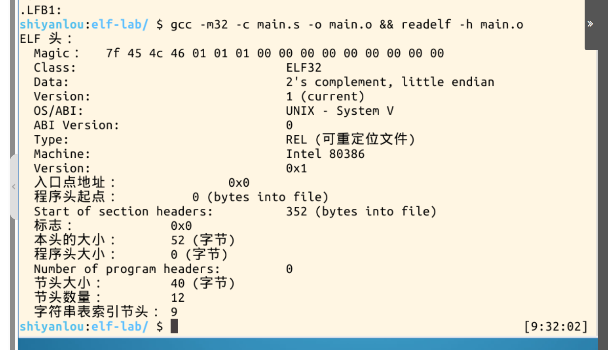
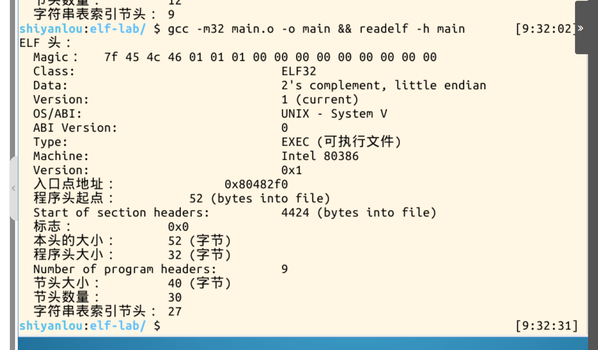
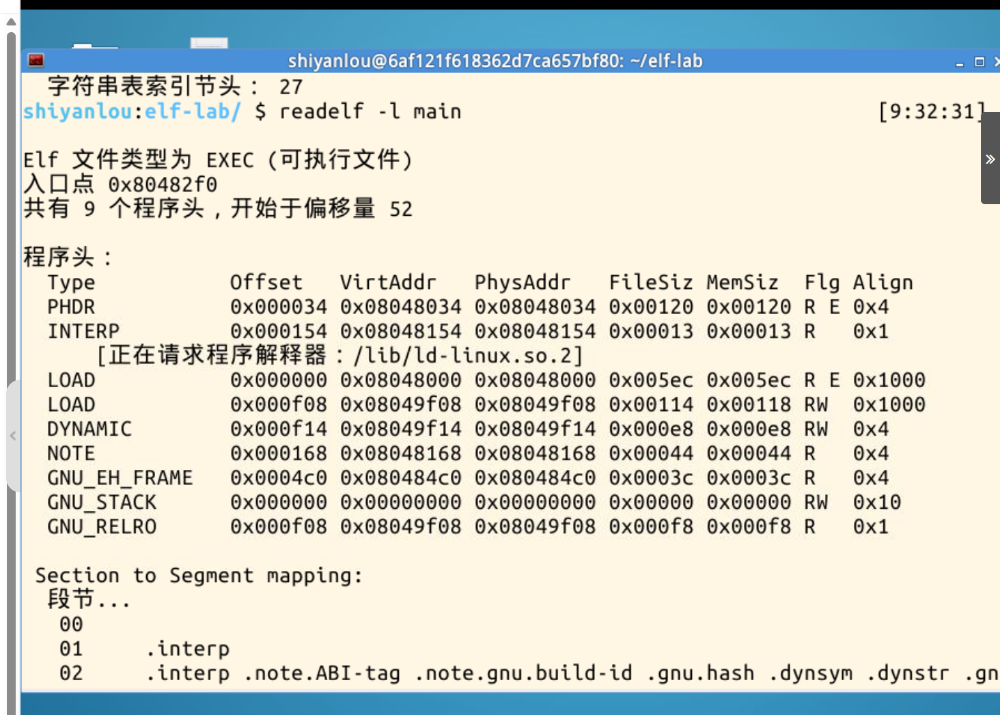
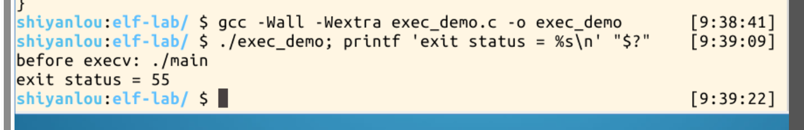
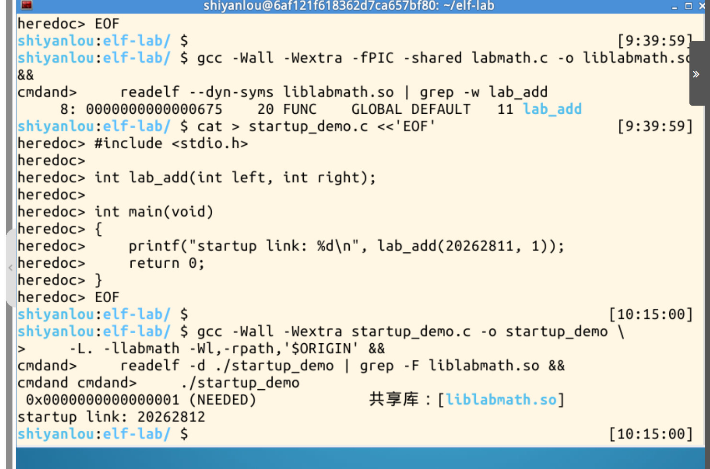
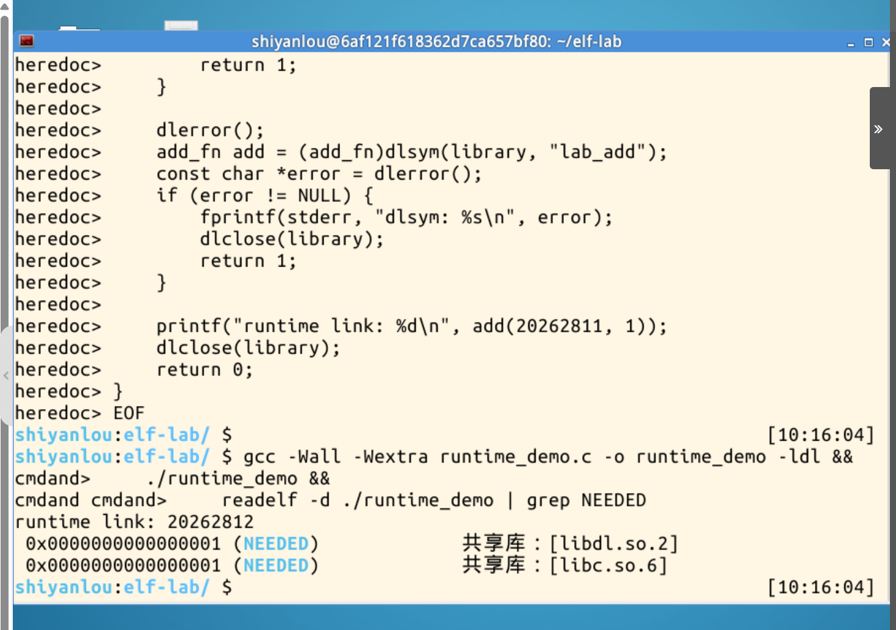
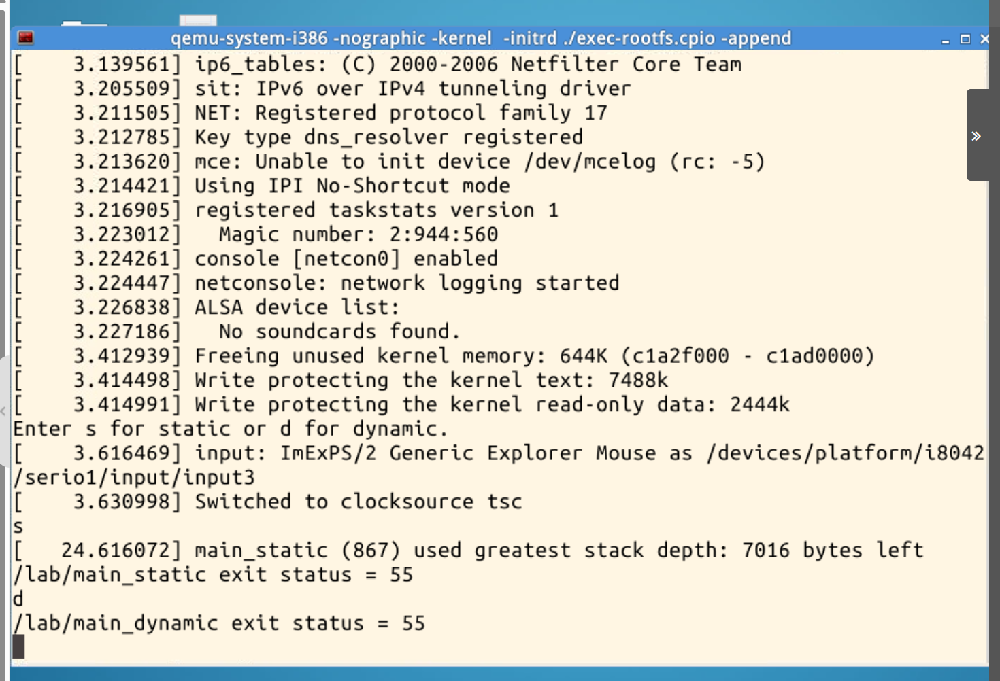
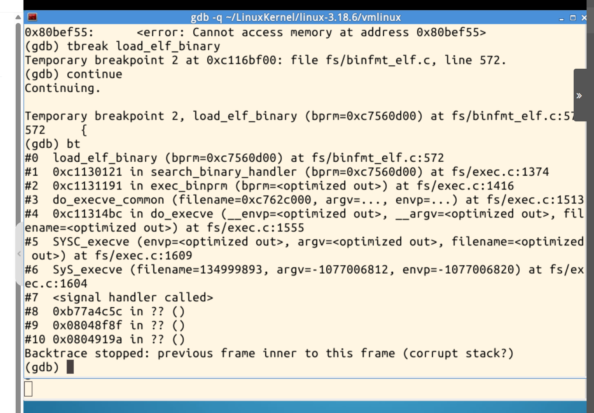
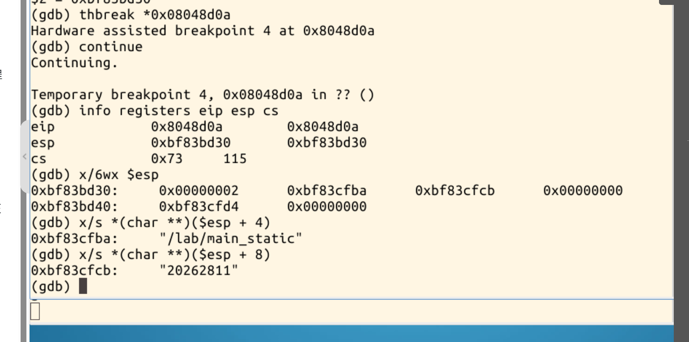
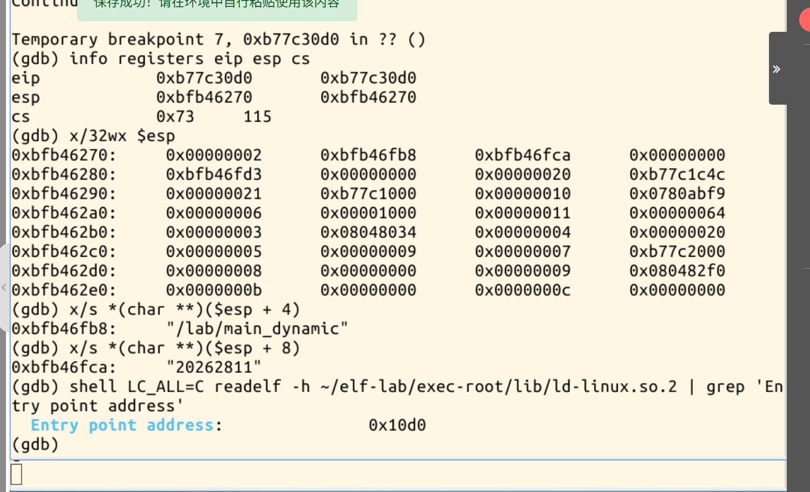

# Linux内核如何装载和启动一个可执行程序

## 一、编译、链接与ELF

沿用第二周作业的`main.c`。用`gcc -m32 -S`生成汇编`main.s`，再用`gcc -m32 -c`生成目标文件`main.o`，最后链接成`main`。两个二进制文件都是`ELF32`。`main.o`的类型是`REL`，程序头数量为0。`main`的类型是`EXEC`，有9个程序头，入口地址`0x080482f0`对应`_start`。





`readelf -l`显示，两个`LOAD`段分别具有可读可执行和可读可写权限。`INTERP`指定动态加载器`/lib/ld-linux.so.2`。



## 二、execv与两种动态链接

`exec_demo`调用`execv()`装载`./main`。Shell读到退出状态`55`，与直接运行`./main`一致。



装载时链接的`startup_demo`把`liblabmath.so`写入`NEEDED`依赖表。启动时装载该库，调用`lab_add(20262811, 1)`得到`20262812`。



运行时链接的`runtime_demo`进入`main()`后才用`dlopen()`打开同一个库，再用`dlsym()`找到`lab_add()`。输出也是`20262812`，而`NEEDED`只列出`libdl.so.2`和`libc.so.6`。



## 三、用GDB跟踪execve

用同一个`main.o`生成静态版和动态版。QEMU里的启动器让子进程调用`execve()`，两版的退出状态都是`55`。



GDB从`SyS_execve`跟到`load_elf_binary()`。入口处直接读取用户地址时出现报错，随后在ELF装载函数中从`bprm->filename`读到了目标路径。

```text
SyS_execve → SYSC_execve → do_execve → do_execve_common
  → exec_binprm → search_binary_handler → load_elf_binary
```



在两版各自的第一条用户态指令处停住，得到以下实测值。

| 链接方式 | `EIP`及起点 | 初始`ESP` | `argv[0]` |
| --- | --- | --- | --- |
| 静态 | `0x08048d0a`，主程序入口 | `0xbf83bd30` | `/lab/main_static` |
| 动态 | `0xb77c30d0`，加载器入口 | `0xbfb46270` | `/lab/main_dynamic` |

两版的初始栈都是`argc = 2`，`argv[1]`都是`20262811`。参数表和环境变量表分别以空指针结束，之后是辅助向量。



动态版的`AT_BASE`为`0xb77c2000`，加上加载器ELF头里的入口偏移`0x10d0`，正好是实测的`EIP`。`AT_ENTRY = 0x080482f0`则给出了主程序的入口。



## 小结

ELF程序头描述文件怎样映射到内存。装载完成后，`start_thread()`把新入口和栈指针写入保存的用户态寄存器。`execve()`成功后，系统调用退出路径恢复的是这个新现场，所以CPU会从新映像开始执行。静态版直接进入主程序，动态版先由加载器完成启动所需的链接，再把控制权交给主程序的`_start`。[Linux 3.18的x86入口设置代码](https://raw.githubusercontent.com/torvalds/linux/v3.18/arch/x86/kernel/process_32.c#L183-L200)
