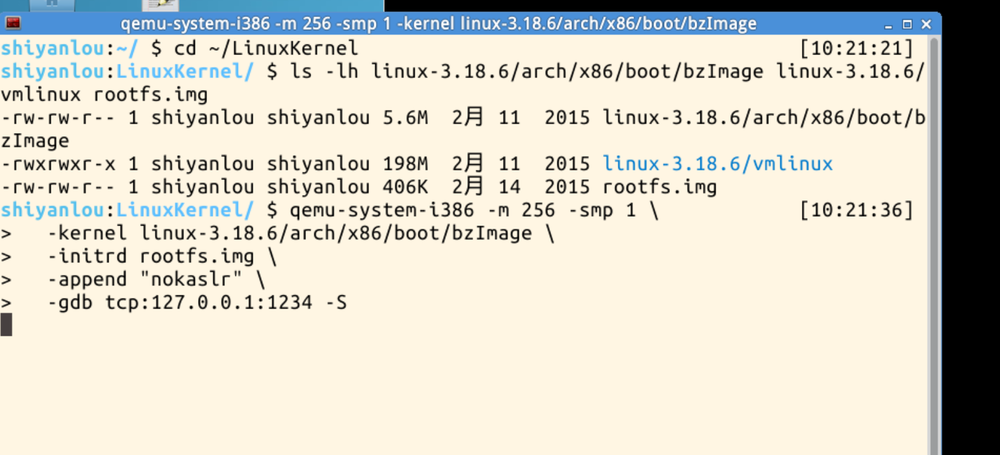
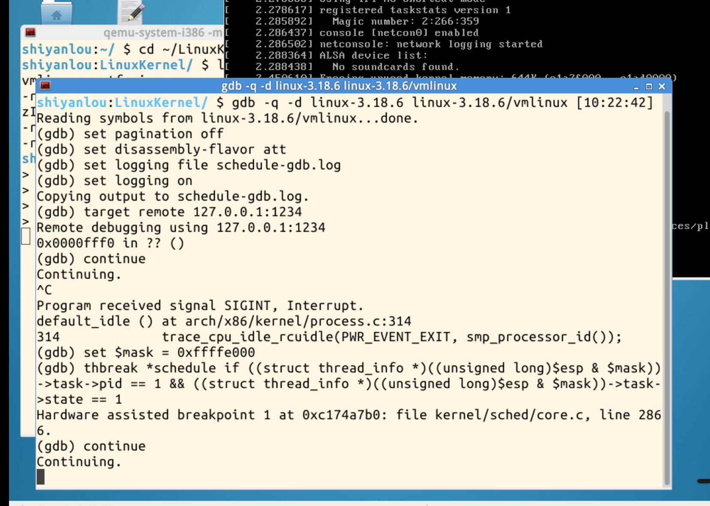
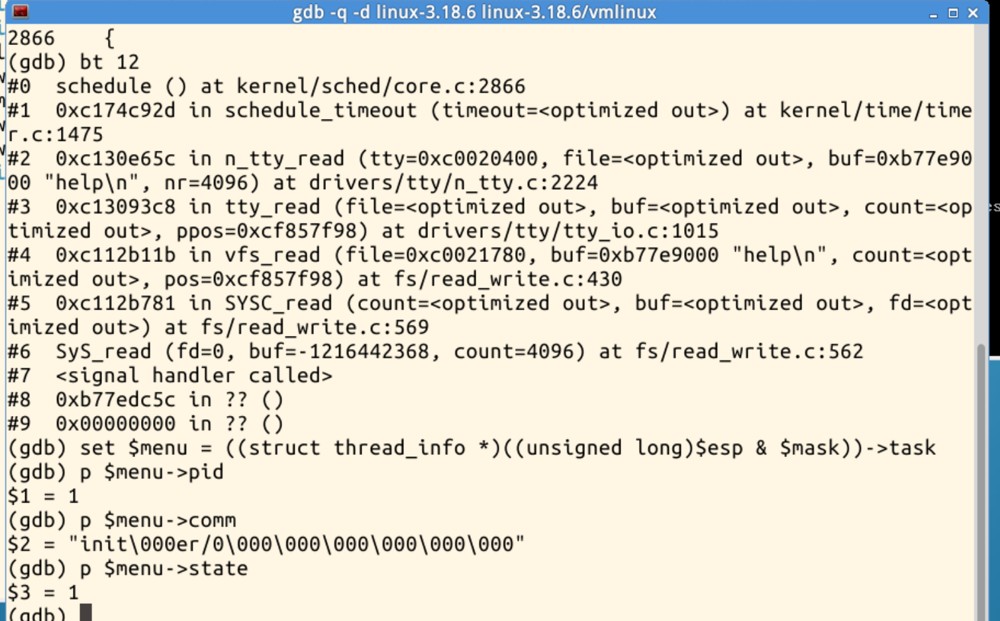
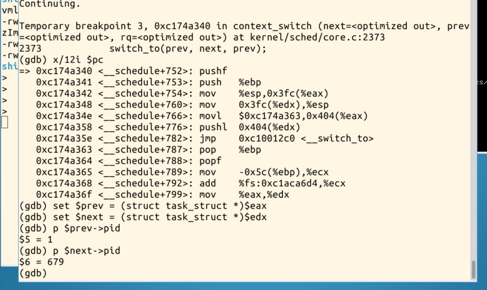
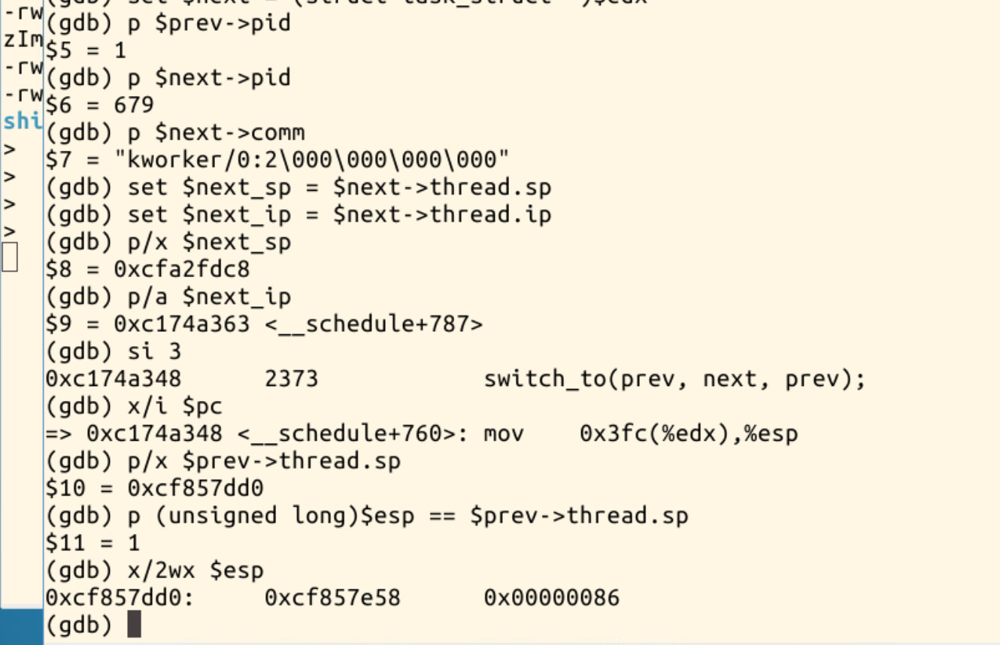
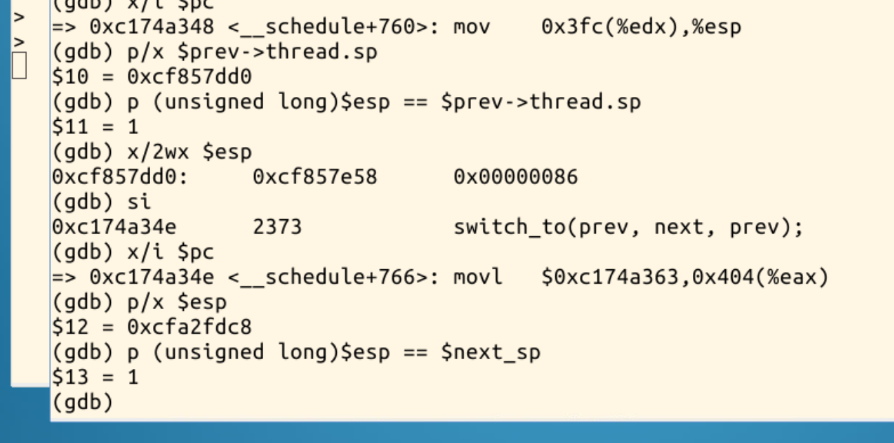
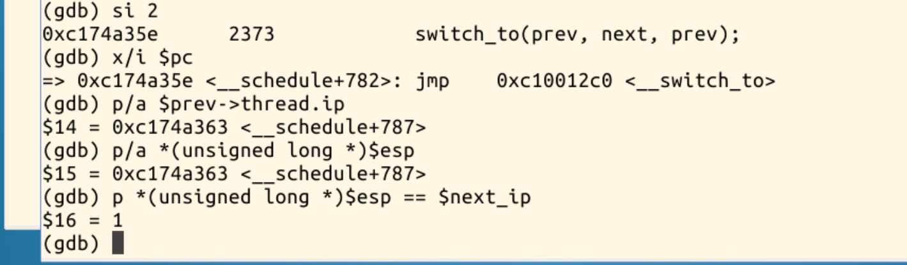
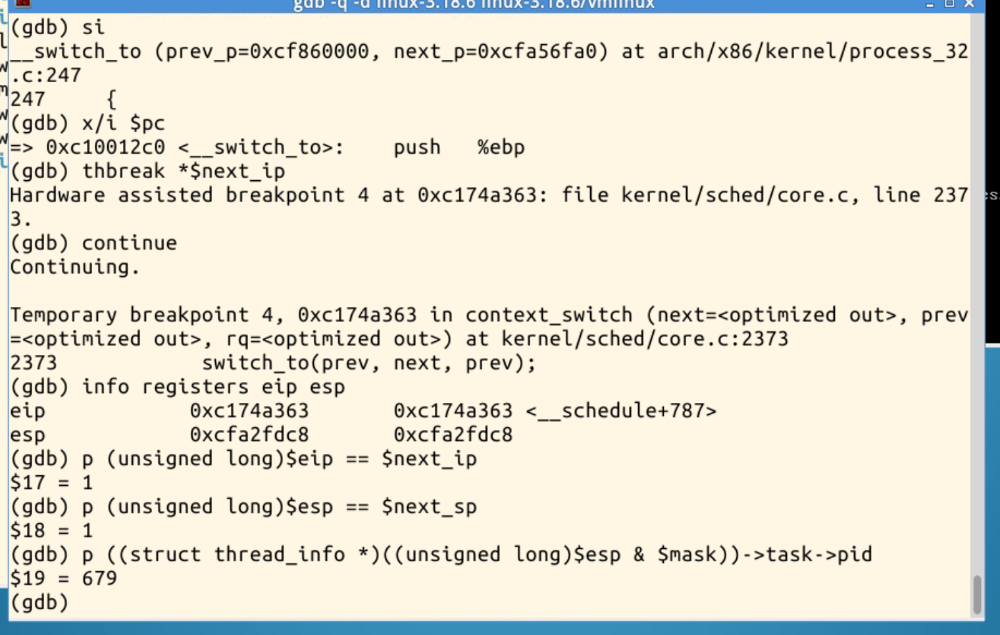
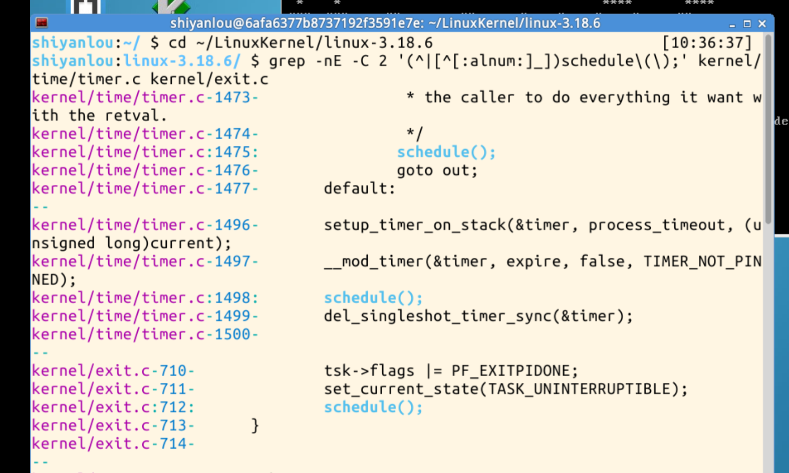
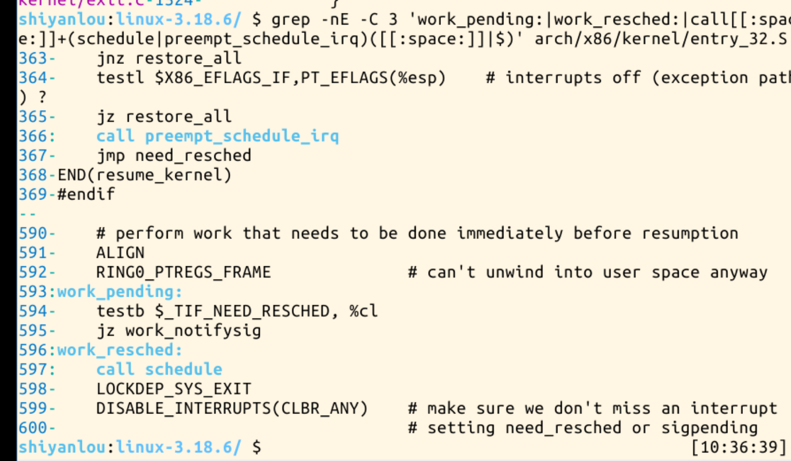

# Linux进程调度与切换实验报告

## 一、启动QEMU并连接GDB

在实验楼虚拟机中使用课程提供的32位Linux 3.18.6和MenuOS。用单核QEMU启动，`-S`让客户机等待GDB。

```bash
cd ~/LinuxKernel
qemu-system-i386 -m 256 -smp 1 \
  -kernel linux-3.18.6/arch/x86/boot/bzImage \
  -initrd rootfs.img -append "nokaslr" \
  -gdb tcp:127.0.0.1:1234 -S
```



在另一终端进入`~/LinuxKernel`，运行`gdb -q -d linux-3.18.6 linux-3.18.6/vmlinux`。用`target remote 127.0.0.1:1234`连接，再用`continue`启动客户机。



## 二、跟踪`schedule()`

看到`MenuOS>>`后，在GDB按`Ctrl+C`暂停，在`schedule()`入口设条件断点，筛选PID为1且处于`TASK_INTERRUPTIBLE`状态的任务。继续运行并在MenuOS输入`help`，下一次等待输入时命中断点。

```text
SyS_read → vfs_read → tty_read → n_tty_read → schedule_timeout → schedule
```



## 三、单步观察`switch_to`

进入`__schedule()`后，在`switch_to`内联汇编的首条指令`pushf`处停住，地址为`0xc174a340`。此时`EAX`指向`prev`（`init`，PID 1），`EDX`指向`next`（`kworker/0:2`，PID 679）。[32位换栈汇编源码](https://github.com/gregkh/linux/blob/v3.18.6/arch/x86/include/asm/switch_to.h)



执行`pushf`和`push %ebp`后，`mov %esp,0x3fc(%eax)`把`0xcf857dd0`写入`prev->thread.sp`。旧栈顶的两个字依次为`EBP = 0xcf857e58`和`EFLAGS = 0x00000086`。



单步执行`0xc174a348`处的`mov 0x3fc(%edx),%esp`后，`ESP`变为`0xcfa2fdc8`，与`next->thread.sp`一致。



接下来将`0xc174a363`写入`prev->thread.ip`，再把`next->thread.ip`压入新栈。两个任务保存的地址恰好相同，指向同一组`pop %ebp`和`popf`指令，各自从自己的内核栈恢复寄存器。



`__switch_to()`返回时，`EIP = 0xc174a363`，`ESP = 0xcfa2fdc8`。从当前栈的`thread_info`读到PID为679，确认CPU已到达该任务的恢复入口。



## 四、核对调度时机

`kernel/time/timer.c`第1475行和第1498行都在`schedule_timeout()`中调用`schedule()`。本次GDB回溯对应第1475行，触发原因是终端读操作阻塞。



`arch/x86/kernel/entry_32.S`第593至597行显示，返回用户态前若发现`_TIF_NEED_RESCHED`已置位，就经`work_resched`调用`schedule()`。启用内核抢占并满足返回条件时，`resume_kernel`还可以调用`preempt_schedule_irq()`。



中断入口保存被打断任务的寄存器现场，返回时可以检查是否需要重新调度。调度器选中另一个任务时，`switch_to`才会切换内核栈和恢复位置。原任务以后重新运行时，仍沿它自己的内核栈继续。

## 五、学习理解

教材9.1.1节以32位x86的Linux 3.18.6说明系统的一般执行过程。我理解，用户任务进内核时保存了返回用户态所需的寄存器，`switch_to`又记录了它在调度器里的内核栈指针和恢复地址。该任务再次获得CPU时，先接回之前的内核路径，走到返回用户态的入口时再恢复用户态现场。

本次`init`在`read()`中等待输入，CPU转去运行`kworker/0:2`，对应9.1.4节的用户进程切向内核线程。9.2.3节以`ls`为例说明了后续过程。终端输入可以让等待的Shell变为可运行，Shell被调度器选中后才继续读取和处理命令。

## 六、实验中遇到的问题

1. 给`switch_to`设断点时，需要确定宏展开后的指令地址。我用`disassemble __schedule`找到首条`pushf`，在`0xc174a340`设下临时硬件断点。
2. GDB把`context_switch()`的`prev`和`next`显示为`<optimized out>`。到达`pushf`时，我按32位换栈汇编的约定从`EAX`和`EDX`读取两个任务指针，再核对各自的PID。
