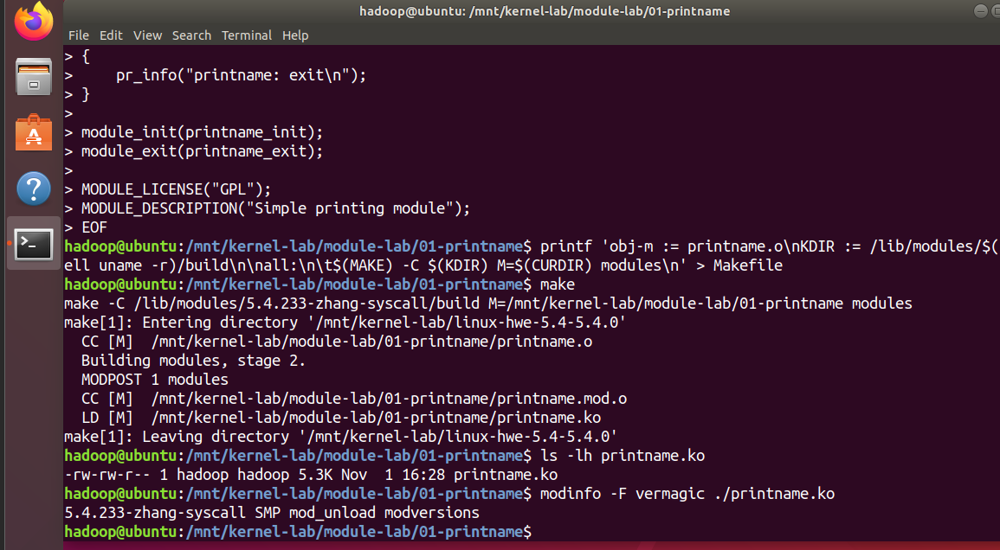
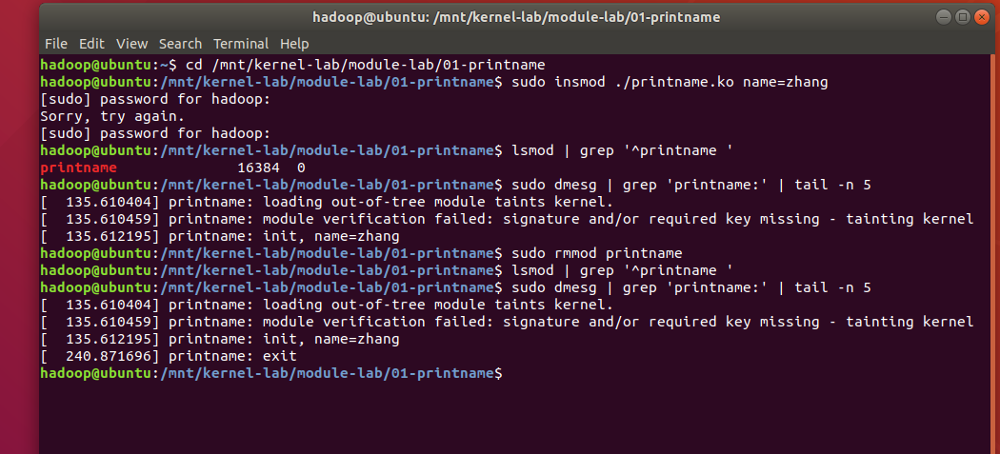
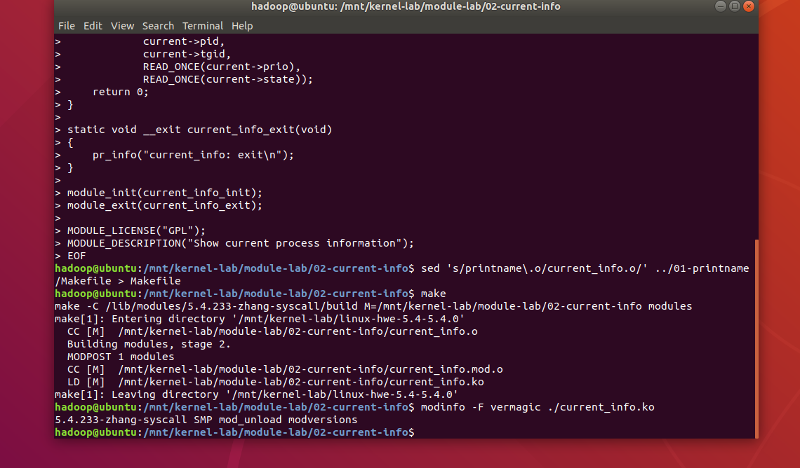
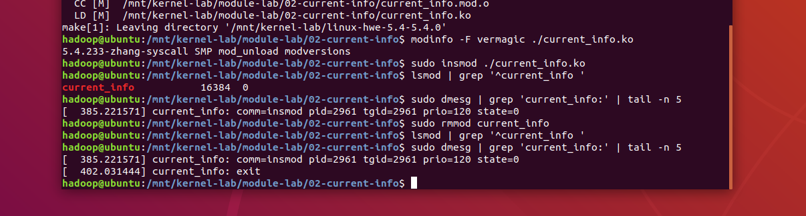
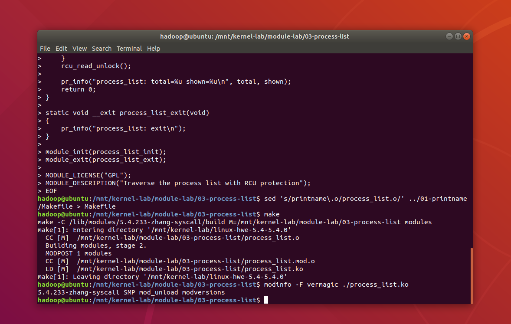
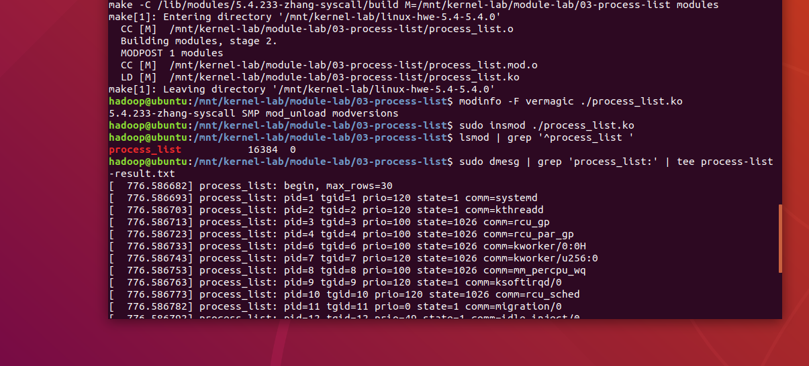
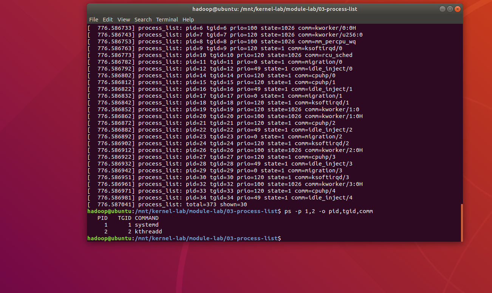
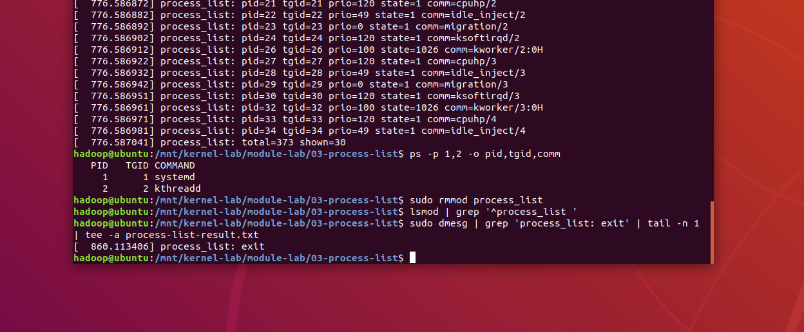

# 20262811《Linux内核原理与分析》内核模块报告

学号：20262811

姓名：张骞

## 一、简单打印模块

### 完整代码

`printname.c`：

```c
#include <linux/init.h>
#include <linux/kernel.h>
#include <linux/module.h>
#include <linux/moduleparam.h>

static char *name = "zhang";
module_param(name, charp, 0444);
MODULE_PARM_DESC(name, "Name printed when the module is loaded");

static int __init printname_init(void)
{
    pr_info("printname: init, name=%s\n", name);
    return 0;
}

static void __exit printname_exit(void)
{
    pr_info("printname: exit\n");
}

module_init(printname_init);
module_exit(printname_exit);

MODULE_LICENSE("GPL");
MODULE_DESCRIPTION("Simple printing module");
```

`Makefile`：

```makefile
obj-m := printname.o
KDIR := /lib/modules/$(shell uname -r)/build

all:
	$(MAKE) -C $(KDIR) M=$(CURDIR) modules
```

### 运行结果

编译生成`printname.ko`。模块版本标记与运行内核`5.4.233-zhang-syscall`一致。



加载模块时传入`name=zhang`，`lsmod`中能看到`printname`，日志输出`init, name=zhang`。卸载后，`lsmod`不再显示该模块，日志新增`printname: exit`。



## 二、当前进程信息

### 完整代码

`current_info.c`：

```c
#include <linux/init.h>
#include <linux/kernel.h>
#include <linux/module.h>
#include <linux/sched.h>

static int __init current_info_init(void)
{
    char comm[TASK_COMM_LEN];

    get_task_comm(comm, current);
    pr_info("current_info: comm=%s pid=%d tgid=%d prio=%d state=%ld\n",
            comm,
            current->pid,
            current->tgid,
            READ_ONCE(current->prio),
            READ_ONCE(current->state));
    return 0;
}

static void __exit current_info_exit(void)
{
    pr_info("current_info: exit\n");
}

module_init(current_info_init);
module_exit(current_info_exit);

MODULE_LICENSE("GPL");
MODULE_DESCRIPTION("Show current process information");
```

`Makefile`：

```makefile
obj-m := current_info.o
KDIR := /lib/modules/$(shell uname -r)/build

all:
	$(MAKE) -C $(KDIR) M=$(CURDIR) modules
```

### 运行结果

编译生成`current_info.ko`，版本标记与当前内核一致。



加载后输出进程名`insmod`，PID和TGID均为2961，优先级值为120，状态值为0（运行或就绪态）。这里读取的是执行模块加载的进程。卸载后模块不再显示，日志输出`current_info: exit`。



## 三、进程链表遍历

### 完整代码

`process_list.c`：

```c
#include <linux/init.h>
#include <linux/kernel.h>
#include <linux/module.h>
#include <linux/rcupdate.h>
#include <linux/sched.h>
#include <linux/sched/signal.h>

static unsigned int max_rows = 30;
module_param(max_rows, uint, 0444);
MODULE_PARM_DESC(max_rows, "Maximum rows to print; 0 means unlimited");

static int __init process_list_init(void)
{
    struct task_struct *task;
    char comm[TASK_COMM_LEN];
    unsigned int total = 0;
    unsigned int shown = 0;

    pr_info("process_list: begin, max_rows=%u\n", max_rows);

    rcu_read_lock();
    for_each_process(task) {
        total++;
        if (max_rows != 0 && shown >= max_rows)
            continue;

        get_task_comm(comm, task);
        pr_info("process_list: pid=%d tgid=%d prio=%d state=%ld comm=%s\n",
                task->pid,
                task->tgid,
                READ_ONCE(task->prio),
                READ_ONCE(task->state),
                comm);
        shown++;
    }
    rcu_read_unlock();

    pr_info("process_list: total=%u shown=%u\n", total, shown);
    return 0;
}

static void __exit process_list_exit(void)
{
    pr_info("process_list: exit\n");
}

module_init(process_list_init);
module_exit(process_list_exit);

MODULE_LICENSE("GPL");
MODULE_DESCRIPTION("Traverse the process list with RCU protection");
```

`Makefile`：

```makefile
obj-m := process_list.o
KDIR := /lib/modules/$(shell uname -r)/build

all:
	$(MAKE) -C $(KDIR) M=$(CURDIR) modules
```

### 运行结果

使用`for_each_process()`遍历进程链表，并加入RCU读侧保护。编译生成`process_list.ko`，版本标记与当前内核一致。



加载后，`lsmod`中能看到模块，日志逐行输出进程的PID、TGID、优先级、状态和名称。默认最多打印30条，达到限制后仍继续遍历并统计总数。



本次结果为`total=373 shown=30`，即遍历时观察到373个进程，打印其中30条。用`ps`抽查PID1和PID2，PID、TGID及名称与模块输出一致，分别为`systemd`和`kthreadd`。进程数量会随运行情况变化，373不是固定值。



卸载后，`lsmod`不再显示该模块，日志输出`process_list: exit`，并追加保存到`process-list-result.txt`。



## 总结

三个模块均完成编译、加载、测试和卸载。通过`lsmod`检查加载状态，通过`dmesg`查看初始化和退出日志，并完成当前进程信息读取与进程链表遍历。实验使用已有的内核构建目录，模块可以单独编译，无需重新编译整个内核。
