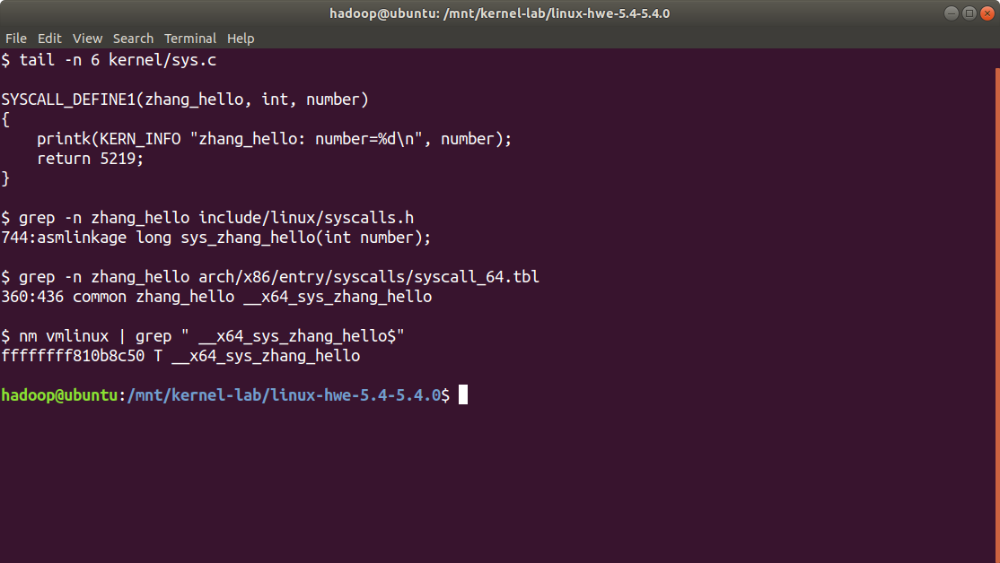
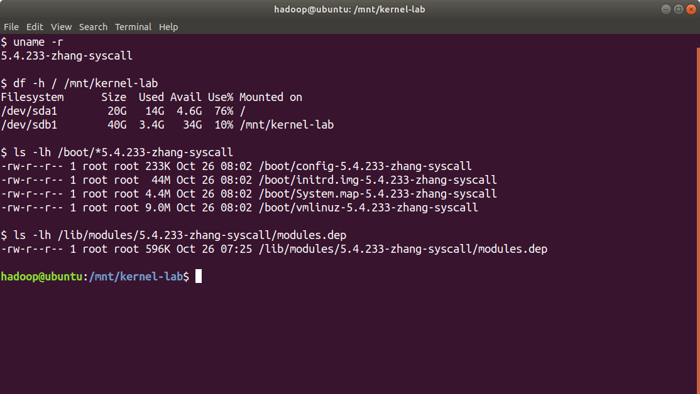
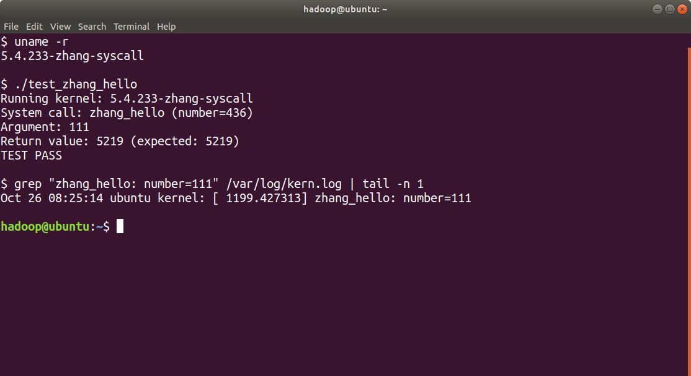

# 编译内核及新增系统调用实验报告

## 实验准备与内核配置

### 磁盘空间与源码目录

原系统盘容量为20GB，开始实验时可用空间约4.9GB。为给源码和编译产物提供空间，新增40GB虚拟硬盘，在`/dev/sdb`上建立`/dev/sdb1`并格式化为ext4，挂载到`/mnt/kernel-lab`。该操作没有扩大原根分区。

在`/etc/fstab`中使用分区UUID配置自动挂载，重启后挂载仍有效。源码和构建产物保存在新增磁盘；`/boot`和`/lib/modules`仍位于系统盘，所以安装前也检查根分区的可用空间。

```bash
lsblk -o NAME,SIZE,FSTYPE,MOUNTPOINT /dev/sda /dev/sdb
df -h / /mnt/kernel-lab
findmnt /mnt/kernel-lab
```

### 安装依赖并获取源码

启用可用的`deb-src`源后，获取与本次Ubuntu环境对应的`linux-hwe-5.4`源码包。编译和修改源码使用普通用户hadoop，安装系统文件时使用`sudo`。主要命令如下。

```bash
sudo apt-get install -y build-essential bc bison flex \
  libncurses5-dev libssl-dev libelf-dev pkg-config wget xz-utils
cd /mnt/kernel-lab
apt-get source 'linux-hwe-5.4=5.4.0-150.167~18.04.1'
cd /mnt/kernel-lab/linux-hwe-5.4-5.4.0
```

源码目录名中的5.4.0是软件包命名的一部分。该源码树的实际基础版本为5.4.233，因此最终内核版本以`make -s kernelrelease`的输出为准，不能仅根据目录名判断。

### 继承现有配置

复制原内核配置，添加自定义版本后缀，关闭调试信息并清空发行版证书文件路径，再通过`olddefconfig`为新增配置项采用默认值。[4]

```bash
cp /boot/config-$(uname -r) .config
./scripts/config --set-str LOCALVERSION "-zhang-syscall"
./scripts/config --disable LOCALVERSION_AUTO
./scripts/config --disable DEBUG_INFO
./scripts/config --disable DEBUG_INFO_BTF
./scripts/config --set-str SYSTEM_TRUSTED_KEYS ""
./scripts/config --set-str SYSTEM_REVOCATION_KEYS ""
make olddefconfig
make -s kernelrelease
```

配置后的版本输出为`5.4.233-zhang-syscall`。后续构建直接在源码目录内进行，构建产物随源码保存在新增磁盘上。

## 系统调用实现与内核编译

本次环境为`x86_64`。检查当前源码的64位调用表后，确认435对应clone3，436尚未使用，选择436作为实验调用号。该编号只适用于这棵已修改的实验源码树。

### 修改源码

在`kernel/sys.c`末尾使用`SYSCALL_DEFINE1`添加函数，通过`printk`记录number并返回5219。在`include/linux/syscalls.h`中增加声明，在`arch/x86/entry/syscalls/syscall_64.tbl`中注册入口，两处新增记录分别如下。

```c
asmlinkage long sys_zhang_hello(int number);
```

```text
436 common zhang_hello __x64_sys_zhang_hello
```

最后一行为系统调用表记录。`__x64_sys_zhang_hello`是本次源码生成的64位入口；使用`nm`核验`vmlinux`后，可以找到该符号。函数、声明、调用表及编译符号的实际检查结果如图1所示。



*图1新增系统调用的实现声明注册及编译符号核验*

### 检查并编译内核

```bash
set -o pipefail
make -j2 kernel/sys.o 2>&1 | tee syscall-check.log && echo "SYSCALL_CHECK_OK"
make -j4 bzImage modules 2>&1 | tee build.log && echo "BUILD_OK"
```

先编译`kernel/sys.o`检查新增代码，再编译内核镜像和模块。完整构建结束时出现`BUILD_OK`。`pipefail`使make失败能够反映到流水线状态中，避免仅因tee成功而误判构建结果。

## 安装内核与设置引导

安装前确认目标版本，并检查`/boot`、根分区及模块目录。模块通过`INSTALL_MOD_STRIP=1`安装；新镜像、配置和符号表分别复制到`/boot`，再生成匹配版本的initramfs并更新GRUB。

```bash
kver=$(make -s kernelrelease)
sudo make INSTALL_MOD_STRIP=1 modules_install
sudo install -m 644 arch/x86/boot/bzImage "/boot/vmlinuz-$kver"
sudo install -m 644 System.map "/boot/System.map-$kver"
sudo install -m 644 .config "/boot/config-$kver"
sudo update-initramfs -c -k "$kver"
sudo update-grub
```

修改引导设置前备份原配置，保留`5.4.0-150-generic`内核。GRUB采用保存的默认启动项，并显示8秒菜单，便于在需要时选择原内核。配置项如下。

```bash
GRUB_DEFAULT=saved
GRUB_TIMEOUT_STYLE=menu
GRUB_TIMEOUT=8
```

首次使用`grub-reboot`指定新内核进行一次性启动，确认启动和测试成功后，再通过`grub-set-default`保存新内核启动项。重启后的`uname -r`输出为`5.4.233-zhang-syscall`。



*图2重启后的内核版本磁盘挂载及启动文件核验*

图2显示，新内核的`vmlinuz`、`initrd.img`、`System.map`和config文件均已生成，模块目录中存在`modules.dep`。核验时根分区可用空间约4.6GB，新增编译分区可用空间约34GB。

## 系统调用测试与结果分析

用户测试程序先用`uname`核对当前内核版本，再执行`syscall(436, 111)`，检查错误码和返回值。版本不是`5.4.233-zhang-syscall`时停止调用，避免误用其他内核的同一编号。

```bash
cd /mnt/kernel-lab
gcc -Wall -Wextra -Werror -O2 test_zhang_hello.c -o test_zhang_hello
./test_zhang_hello
```

内核日志可通过`dmesg`读取。本次截图使用当前用户可读的`/var/log/kern.log`核对`printk`输出，筛选`zhang_hello: number=111`。用户程序输出和对应内核日志如图3所示。



*图3新增系统调用的实际测试结果*

### 结果判定

| 核验项目 | 预期结果 | 实际结果 |
| --- | --- | --- |
| 运行内核 | `5.4.233-zhang-syscall` | `5.4.233-zhang-syscall` |
| 调用号与参数 | 436，111 | 436，111 |
| 返回值 | 5219 | 5219 |
| 内核日志 | `zhang_hello: number=111` | `zhang_hello: number=111` |

用户返回值5219与内核日志中的`number=111`分别验证了返回结果和参数传递。本次测试覆盖一个整数参数及固定返回值，新增系统调用的基本调用链通过验证。

## 问题处理与实验总结

### 实验中遇到的问题

网络未连接。软件源更新曾提示域名无法解析。检查发现`ens33`处于DOWN状态，且没有默认路由；启用网络管理并连接网卡后，获取到地址和默认路由，apt更新恢复。主要处理命令如下。

```bash
sudo nmcli networking on
sudo nmcli device connect ens33
```

源码包名称与内核版本容易混淆。仓库查询未找到`linux-source-5.4.0`，随后使用`linux-hwe-5.4`源包。目录名、Ubuntu软件包版本和内核基础版本分别用于不同用途，最终通过`make -s kernelrelease`确认实验内核版本。

系统盘空间余量有限。采用新增磁盘并挂载编译目录的方式，为编译预留空间。挂载目录容量增加并不会扩大根分区，安装镜像和模块前仍需检查系统盘剩余空间。

